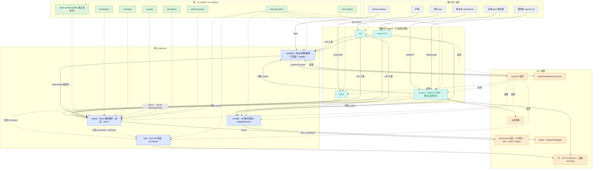

# Microduck 架构图提示词（软件架构 + 硬件爆炸图）

> 本文是为 microduck 生成**两张图**而写的专业提示词与风格规范：
> 1. **软件架构图**——有哪些模块、之间怎么通讯；
> 2. **硬件爆炸图**——按实物结构展开：电路板、舵机、音频、嘴、脚等。
>
> 所有事实均忠于仓库：软件侧依据 [`microduck/docs/design/architecture.md`](../../microduck/docs/design/architecture.md) 与代码；硬件侧依据运动学模型 [`robot_walk.xml`](../../microduck/kinematics/assets/alpha/robot_walk.xml)、[`deploy/`](../../microduck/deploy/) 与 `duck-control` 常量。生成后的图片建议存到本目录 `docs/diagrams/`，并在 [`docs/README.md`](../README.md) 引用。

---

## 系列索引与编号约定（docs/diagrams/）

| 编号 | 文件 | 内容 |
|---|---|---|
| 00 | `00-prompts.md` | 提示词总账（本文件）：各页提示词、风格语法、踩坑教训 |
| 01 | `01-software-architecture.{json,svg,png}` | 工程版架构图（fireworks 管线，图即代码） |
| 02 | `02-software-architecture-poster.{svg,png}` | 信息图海报系列·页 1：软件架构与通信拓扑 |
| 03 | `03-control-plane-bus-poster.{svg,png}` | 信息图海报系列·页 2：控制面总线深入 |
| 04 | `04-control-links-poster.{svg,png}` | 信息图海报系列·页 3：控制链路——前门与仲裁 |
| 05 | `05-hardware-exploded.{svg,png}`（规划中） | 硬件爆炸图：电路板 / 舵机 / 音频 / 嘴 / 脚（见 §2、§4 落地建议） |
| — | `assets/` | 源资产与风格参考：microduck.jpg（真鸭照）、duck-mascot.png（吉祥物裁切）、ref-*.jpg（参考图截图） |

**编号约定**：交付物编号 = 生成顺序，同名 svg/png/json 共用一个号；新页顺延取号（当前已排至 04，硬件图顺延为 05），其提示词与 brief 以新 § 追加进本文件；源图/参考图不编号，一律入 `assets/`。

## 0. 先定工具：两张图性质不同，别用同一把锤子

| 图 | 本质 | 推荐工具 | 为什么 |
|---|---|---|---|
| **软件架构图** | 带**精确文字标签**的框线图 | **图即代码**：Mermaid / Graphviz / `fireworks-tech-graph` 技能 → 导出 SVG/PNG | 文生图模型渲染密集文字与箭头**不可靠**（标签会变乱码）；图即代码文字 100% 准确、可版本管理、可迭代 |
| **硬件爆炸图** | 半写实 **3D 装配插画** | **文生图**（ImageGen / Midjourney / DALL·E）或 Blender 渲染 | 这是艺术化实物呈现，正是文生图模型的强项 |

因此下面**软件图给两版**：§1.2 版本 A（结构化规范，推荐，可直接渲染）与 §1.3 版本 B（文生图提示词，要海报/插画感时用，文字可能失真）。**硬件图**以文生图提示词为主（§2.2）。

---

## 1. 软件架构图

### 1.1 必须画进去的事实（忠于代码）

**分四层**（自上而下）：客户端/远端 → 传输层 daemon → 核心 daemon → 库 → OS/硬件。

**模块清单**（节点）：

| 层 | 模块 | 拥有什么 / 监听 | 一句话 |
|---|---|---|---|
| 客户端 | 手柄、手机 App、笔记本(`robotctl`/ssh)、远端 peer/浏览器、服务端 agent/LLM、GitHub release | — | 都发**完全相同**的调用 |
| 传输 | `padd` | `/run/padd/pad.sock` | 手柄传输，非特权客户端 |
| 传输 | `btd` | BLE GATT | **无状态** BLE 适配器，只转发 API 子集 |
| 传输 | `robotctl` | — | 本地 CLI，**坏机器上也必须能用** |
| 传输 | `mediad` | TCP `:8080`(console)/`:8443`(signalling) | WebRTC 远程网关 + 相机/音频管线（最重） |
| 核心 | `robotd` | `/run/robotd.sock` · `robot.*` | **唯一能碰电机**；50 Hz 控制循环 + 安全层 |
| 核心 | `configd` | `/run/configd.sock` · `net/pad/system` | wifi/身份/配对 PIN/手柄绑定 |
| 核心 | `updaterd` | `/run/updaterd.sock` · `update.*` | 验证/原子切换/健康门/回滚 |
| 核心 | `tofd` | `/run/tofd/tof.sock` · `tof.stream` | 头部 8×8 ToF 深度，**只发布不读取** |
| 库 | `duck-ipc-proto` | — | 线上契约（wire types），只依赖 serde/semver |
| 库 | `duck-control` | — | model·bus·imu·io·obs·policy·**safety**（独占电机写句柄） |
| 库 | `kinematics` / `odometry` / `sounds` / `pet-detect` / `duck-detect` / `robotd-params` | — | FK / 里程计 / 合成音 / 摸头 CNN / 鸭子检测 / 参数 schema |
| OS/硬件 | `systemd`、Dynamixel 总线(15 舵机+IMU, UART 1Mbps)、BlueZ·NetworkManager(D-Bus)、I²C(ToF+音频)、头部相机、`/opt/robot/daemon/current` | — | 底层依赖 |

**通讯（带协议标签的边）**：

- 手柄 →(BLE/USB)→ `padd`；手机 →(BLE GATT)→ `btd`；peer/浏览器 →(WebRTC: 视频/音频轨 + datachannel `control`/`teleop`)→ `mediad`；agent/LLM →(WebSocket, `get_frame` JPEG)→ `mediad`；GitHub →(https)→ `updaterd`
- `padd`/`btd`/`robotctl`/`mediad` →(**JSON-RPC 2.0 / NDJSON over unix socket**)→ `robotd`/`configd`/`updaterd`
- `mediad`、`robotd` ⇢(订阅 `tof.stream`)⇠ `tofd`（虚线：只读订阅）
- `configd` →(D-Bus)→ BlueZ/NetworkManager；`updaterd` →(systemctl restart)→ systemd、→(问 `robot.health` 健康门)→ `robotd`、→ 移动 `current` 软链
- `robotd` →(一次 `sync_read` + 一次 `sync_write`)→ Dynamixel 总线；`tofd` →(I²C)→ VL53L5CX；`mediad` → 相机 + I²C 音频
- 核心 daemon ⇢(编译期 `use`)⇠ 各库；systemd ⇢(监管/重启/watchdog)⇠ 所有 daemon

**两条必须标注的"面"**：
- **控制面**：JSON-RPC/NDJSON over unix socket，几十字节、≤100 Hz。
- **数据面**：视频/音频帧**从不跨 socket**（"感知就近放在传感器旁，只传特征不传帧"）。

**三条不变量（建议在图上以徽标/批注呈现）**：
1. `configd`/`updaterd`/`btd` 能在 `robotd` 死掉时存活（**恢复路径**）。
2. `robotd` 对安全有最终权威；客户端发**意图（intents）**，不是电机写入。
3. 控制循环**永不阻塞**在别的服务上（跨服务读取都是 last-value-wins 缓存）。

### 1.2 版本 A（推荐）：结构化图规范 / Mermaid

把下面这段喂给 Mermaid（或 `fireworks-tech-graph` 技能）即可得到文字精确的矢量图。配色见 §3。



> 若嫌连线太密，可把"库 ⇢ daemon"的 `use` 边和 `systemd` 监管边折叠成一个批注框；**控制面用实线、数据面/订阅用虚线**是这张图最重要的可读性规则。

### 1.3 版本 B：文生图提示词（海报/插画风，文字可能失真）

**中文意图**：一张干净的**技术信息图（infographic）**，扁平矢量风，分四层自上而下：客户端、传输守护进程、核心守护进程、底层库与硬件。圆角矩形节点、正交折线箭头，控制面实线、数据面虚线，按层配色（见 §3），浅色背景，右上角小字标注三条不变量。**纵横比 16:9，高分辨率。**

**English prompt**：
```
A clean flat-vector technical infographic of a robot software architecture, layered
top-to-bottom: clients/remote actors, transport daemons, core daemons, libraries,
OS/hardware. Rounded-rectangle nodes, orthogonal connector arrows, solid lines for
the control plane and dashed lines for the data plane, color-coded by layer, light
neutral background, subtle drop shadows, crisp sans-serif labels, a small legend and
three invariant callouts. Isometric-free 2D diagram, professional documentation
aesthetic, high detail, 16:9.
```
**Negative prompt**：`photorealism, 3D render, cluttered, overlapping lines, neon, dark background, gibberish text, watermark`

---

## 2. 硬件爆炸图

### 2.1 必须画进去的实物事实（忠于 MJCF + deploy + 代码）

**整机**：约 **25 cm 高、800 g** 的**鸭子形态双足机器人**。

**部件清单（BOM，按身体区域）**：

| 区域 | 部件 | 关键事实 |
|---|---|---|
| **头部** | 头壳(`bottom_head_shell`)、**喙/嘴**(`mouth_tip`)、**头部相机**、**ToF 传感器**、4 个颈/头舵机 + 1 个喙舵机 | 相机 + ToF(VL53L5CX 8×8) 并排在头部；喙由独立舵机开合（`MOUTH_INDEX=9`, ID 34），随叫声/特雷门琴张合 |
| **颈部** | neck 连杆 | `neck_pitch → head_pitch → head_yaw → head_roll` 四关节（ID 30–33） |
| **躯干** | 躯干壳(`trunk_base`)、**主板**、**IMU 板**、**音频 codec + 喇叭 + 麦克风**、**电池** | 主板 = Radxa Zero 3W（Rockchip RK3566, 四核 Cortex-A55, aarch64）；IMU = `imu_to_dxl v2`（ST LSM6DSV16X 六轴，**片上 SFLP 融合**，在总线上是 Dynamixel **ID 200**）；音频 = TI **AIC3104** codec（I²C，**与 ToF 共享同一条 I²C**）；电池 = NP-F550 型 **2S 锂离子**（7.4V 标称，满 8.2V / 空 6.6V） |
| **左腿** | 5 个舵机 + 连杆 + **脚** | `hip_yaw→hip_roll→hip_pitch→knee→ankle`（ID 20–24），脚底有**足端接触**点（供里程计） |
| **右腿** | 5 个舵机 + 连杆 + **脚** | 同上（ID 10–14） |
| **选配** | 轮子 | 装上后走 `roller` 滚动步态 |

**舵机总数 = 15**：左腿 5 + 右腿 5 + 颈/头 4 + 喙 1。全部是 **Dynamixel XL330 智能舵机**。

**两条物理总线（爆炸图里可用线束/走线表现）**：
- **UART `/dev/ttyS2` @ 1 Mbps**：**半双工** Dynamixel Protocol 2.0，**菊花链（daisy-chain）**串起 15 个舵机 + IMU 板（ID 200）。
- **I²C**：ToF(VL53L5CX) 与音频 codec(AIC3104) **共享**。
- **电源**：电池 → 舵机(7.4V) + 主板(稳压)。

### 2.2 文生图提示词（专业版）

**中文意图**：一张**半写实 3D 技术爆炸图（exploded view / teardown illustration）**，等轴测或 3/4 透视，一只**鸭子形态的双足机器人**沿装配轴分解悬浮：最上是头壳与喙、头部相机镜头、ToF 阵列、颈/头舵机；中部是躯干壳、绿色主板(Radxa Zero 3W)、传感器 HAT(IMU + 音频 codec)、喇叭、麦克风、2S 电池；下方左右两条腿各 5 个深色舵机 + 连杆 + 脚。舵机按肢体分色，一条菊花链线束串起所有舵机与 IMU。细引线 + 小号标签指向各部件。柔和影棚光、浅色中性背景、轻微投影。**纵横比 3:2 或 16:9，高分辨率。**

**English prompt**：
```
A semi-realistic 3D technical exploded-view illustration (product teardown style) of
a small duck-shaped bipedal robot, ~25 cm tall, parts floating apart along their
assembly axes in isometric 3/4 perspective. TOP: duck head shell with an openable
beak, a small camera lens, an 8x8 time-of-flight sensor array, and 5 compact smart
servos for neck/head/beak. MIDDLE: duck body torso shell, a green PCB single-board
computer (Rockchip SoC), a sensor HAT with a 6-axis IMU and an audio codec, a tiny
speaker, a microphone, and a 2S lithium-ion battery pack. BOTTOM: two bird legs, each
with 5 dark smart servos (hip yaw/roll/pitch, knee, ankle), linkage and a webbed foot.
Servos color-coded per limb; a single daisy-chain wiring harness threads through all
servos and the IMU board (one shared serial bus). Thin leader lines with small clean
labels point to each component. Soft studio lighting, light neutral background, subtle
contact shadows, matte plastic + aluminum + copper-gold PCB contacts, engineering
documentation aesthetic, high detail, 3:2.
```
**Negative prompt**：`cartoon, low-poly, blurry, human, extra limbs, text-heavy gibberish, dark background, watermark, deformed`

> **标注文字提示**：文生图模型同样难以精确渲染零件名。若要标签准确，建议**先出无标签的爆炸图**，再在 Figma/draw.io/Blender 里手动加引线标签（用 §2.1 的部件名）。

### 2.3 （可选）3D 渲染路线

若追求工程级精确，可用 Blender：导入/参照 MJCF 连杆树搭骨架，按 §2.1 BOM 建模，用装配约束做爆炸位移，再打光渲染。文字标签走 SVG 叠加层，最准确。

---

## 3. 图片风格总则（两张图统一的视觉语言）

让两张图像"同一套资料"，共享色板、字体、背景、标注风格：

- **配色（语义一致）**：
  - 鸭子主题强调色：**鸭黄 `#F5B301`**（用于硬件外壳 / 软件图高亮 `robotd`）。
  - 软件分层：客户端 `#ECEFF4` 灰、传输 `#D6F5F2` 青、核心 daemon `#DCE6FF` 蓝、库 `#DFF3DC` 绿、OS/硬件 `#FCEBCF` 琥珀、数据面虚线 `#E23D3D` 红。
  - 硬件材质：舵机深灰 `#2E3138`、PCB 绿 `#1F7A4D` + 金色触点 `#D4A017`、外壳鸭黄、铝/银 `#C7CCD4`、铜线 `#B87333`。
- **线**：实线 = 控制/电源/结构；虚线 = 数据面/订阅/编译期依赖。箭头细、正交折线（软件图）。
- **字体**：无衬线（Inter / IBM Plex Sans / 思源黑体），标签小号、深色 `#222`，避免花体。
- **背景**：浅色中性（`#FAFAFA` / 柔和渐变），轻微投影，不抢主体。
- **标注**：硬件图用**细引线 + 端点小圆点 + 小号标签**；软件图用**节点内文字 + 边上协议标签**。
- **纵横比 / 分辨率**：软件图 **16:9**（宽屏文档/PPT）；硬件爆炸图 **3:2 或 16:9**；均出**高分辨率**（≥2048px 长边），矢量优先（软件图导 SVG）。
- **一致性**：两图共用上述色板与字体，标题/图注风格统一。

---

## 4. 落地建议

1. **软件图**：优先用 §1.2 的 Mermaid（或 `fireworks-tech-graph` 技能）导出 **SVG**，文字精确、可随代码演进 diff；要海报感时再用 §1.3。
2. **硬件图**：用 §2.2 英文提示词喂文生图；先出**低分辨率草稿**确认构图与部件齐全，再出高清；标签建议后期手动叠加（§2.2 提示）。
3. 生成物存到 `docs/diagrams/`（如 `01-software-architecture.svg`、`05-hardware-exploded.png`），并在 [`docs/README.md`](../README.md) 第 2 节引用。
4. 迭代顺序：**先软件图（信息密度高、需准确）→ 再硬件图（艺术化、可多版择优）**。

### 4.1 实测渲染要点（fireworks-tech-graph 踩坑记录，2026-09 验证）

交付物：`01-software-architecture.json`（数据源，可版本化）/ `.svg` / `.png`，`05-hardware-exploded.png`。复现：

```bash
SKILL_ROOT="/Users/damon/.qoder/skills/fireworks-tech-graph"
python3 "$SKILL_ROOT/scripts/generate-from-template.py" architecture \
  docs/diagrams/01-software-architecture.svg < docs/diagrams/01-software-architecture.json
bash "$SKILL_ROOT/scripts/validate-svg.sh" docs/diagrams/01-software-architecture.svg
python3 -c "import cairosvg; cairosvg.svg2png(url='docs/diagrams/01-software-architecture.svg', write_to='docs/diagrams/01-software-architecture.png', output_width=2560)"
```

踩过的坑与解法（都是 cairosvg / 生成器的真实行为，非猜测）：

1. **中文变豆腐**：cairosvg 不做逐字形字体回退，会锁定字体栈里**第一个**可用字体。style-1 默认栈 `'Helvetica Neue', …, 'PingFang SC', …` 把无 CJK 的 Helvetica 放前面 → 中文全成 □。解法：JSON 加 `style_overrides.font_family`，把 `'PingFang SC'` 提到首位。
2. **特殊符号也豆腐**：`≤ × ² →` 在 cairosvg+PingFang 下同样渲染为 □（而 `·`、`——` 正常）。标签里改用 ASCII：`<=`、`x`、`2`、`->`。
3. **容器顶部 header 挡线**：容器的 `label`/`header_prefix` 会在**左上角**生成一块路由障碍物，正好压住最左列的竖直连线（报 `no collision-free orthogonal route`）。解法：改用 `side_label`（不产生障碍物），放在容器底部内侧空白条。
4. **composition 质量门分档**：`showcase`（节点间距≥40px、总拐角≤8、零交叉）适合稀疏营销图；28 节点的真实架构过不了。用 `standard` 档 + 轻度收紧（`min_node_gap:10`、`min_container_gutter:4`）。注意"箭头不穿过节点"是路由器硬约束，与档位无关，始终生效。
5. **宽 bus 节点无法每列纯竖直**：多条箭头共用一个端口时只在中心 ±18px 内展开，所以 transport→bus→core 必然在 bus 中心聚拢、产生横向 jog（hub 观感，可接受）。别为"全竖直"和它较劲。
6. **footer 过长会被右边界裁切**：控制在一行能放下的长度（约 70 字内）。

---

## 5. 信息图海报风（参考图反推：产业链图式样）

参考图 = 中文产业链信息图海报（竖版、扁平、实色分区面板）。本节把它的风格/布局抽成可复用提示词骨架，再改写成 microduck 软件架构版。

### 5.1 风格提取（可复用提示词骨架）

**风格 prompt**：
- 竖版 2:3；暖白底 `#FAF8F5`；扁平矢量、无渐变、无阴影；仅右上角产品渲染图允许 3D。
- 三段分区色：橙 `#F97316` / 蓝 `#2563EB` / 绿 `#16A34A`；亮点卡米白 `#F7F4EF`；卡片 1px 浅灰边、圆角 8px。
- 无衬线黑体（PingFang / 思源黑体）；五级字阶：两行超大标题（第二行关键词橙色）> 分区横幅（实色底白字）> 编号列题（小图标+加粗）> 卡片名（加粗）> 描述（超小灰）。
- 签名元素：分区横幅 = 面板左上实色圆角 tab；高亮卡 = 橙边 + 浅橙底 + 星徽；流程 = 实色箭头横穿连接卡片；页脚 = 灯泡图标 + 灰总结 + 右侧超小"注："。

**布局 prompt**（自上而下语法）：
1. Header：两行主标题 + 灰副标题（`|` 分隔）+ 右上产品渲染图（无边框）。
2. 亮点行：3 张等宽米白卡（图标 + 加粗标题 + 2–3 行超小灰字）。
3. K 个分区面板：实色横幅 tab + 白色圆角面板；面板内 N 列（图标 + 编号列题 + 堆叠卡片）；某一行可换成"横排卡片 + 箭头"表达流程。
4. Footer：灯泡 + 一行灰总结 + 右侧超小注。

### 5.2 microduck 软件架构版提示词

映射：三分区 = 客户端与传输（橙）/ 核心 daemon（蓝）/ 硬件与库层（绿）；亮点三卡 = 核心设计 / 恢复路径 / 单一写者；流程行 = 传输 -> 总线 -> 核心。

**中文版**（喂即梦/通义万相等中文模型）：

```text
中文科技信息图海报，竖版 2:3，扁平矢量，暖白底 #FAF8F5，无渐变无阴影。
顶部两行超大黑体标题：第一行黑"Microduck开源机器鸭"，第二行"软件架构与通信拓扑"其中"软件架构"橙色 #F97316；标题下一行超小灰副标题"多守护进程 | 一条 JSON-RPC 总线 | robotd 唯一碰电机"；右上角橙白双足鸭子机器人 3D 渲染图，无边框。
标题下一排三张等宽米白 #F7F4EF 圆角亮点卡，每卡左侧橙色线框图标 + 加粗小标题 + 两行超小灰字："核心设计：控制面几十字节 <=100Hz、数据面从不跨 socket""恢复路径：btd/configd/updaterd 在 robotd 死时存活""单一写者：每份状态一个写者、控制循环永不阻塞"。
随后三个白色圆角面板纵向堆叠，每个面板左上一个实色圆角横幅 tab、白色粗体字：
面板1 橙色横幅"客户端与传输：指令如何到达"，内 4 列，每列小橙图标 + 编号加粗列题 + 浅灰边小卡（两行超小灰字）："1. 手柄 -> padd（BLE/USB）""2. 手机 -> btd（BLE GATT 无状态）""3. 笔记本 -> robotctl（ssh CLI）""4. 远端 -> mediad（WebRTC）"。
面板2 蓝色横幅 #2563EB"核心 daemon：各自拥有一个 unix socket"，内一条细长条"JSON-RPC 2.0 / NDJSON 总线"，其下 4 张卡横排、实心蓝箭头连接："robotd 50Hz 控制循环·安全"（该卡橙边 + 浅橙底 + 星徽）、"configd wifi/身份/配对"、"tofd 8x8 ToF 只发布"、"updaterd 验证/切换/回滚"。
面板3 绿色横幅 #16A34A"硬件与库层"，3 列："1. Dynamixel 总线：15 个 XL330 舵机 + IMU，UART 1Mbps""2. 传感器：ToF VL53L5CX + 音频 AIC3104 共享 I2C、头部相机""3. 库层：duck-ipc-proto wire 契约、duck-control、kinematics、sounds"。
底部：灯泡图标 + 一行灰字"数据面（视频/音频帧）从不跨 socket；感知就近放传感器旁，只传特征不传帧。" + 右侧超小灰"注：依据 architecture.md"。
无衬线黑体，留白充足，1px 浅灰卡片边框，圆角 8px，扁平，高细节。
```

**英文版**（ImageGen / DALL·E）：布局描述同上，标签文字保留上面的中文字串让模型照排；若模型中文渲染差，可退化为英文短标签（robotd / configd / JSON-RPC bus …）保真度更高。
**Negative prompt**：`blurry, gibberish text, broken Chinese characters, dark background, gradients, shadows, watermark, photo realism, 3D except robot`

### 5.3 保真警告与推荐路线

- §0 的结论仍然成立：文生图对**密集中文文字**不可靠。此海报风适合做演示封面/传达气质；承载准确架构信息请用图即代码（§1.2 / §4.1 已有 `01-software-architecture.svg`）。
- 若要"海报风 + 精确文字"：按 §5.1 布局语法手写 SVG（横幅/卡片/箭头都是简单几何），cairosvg 导出，注意 §4.1 的 CJK 字体与特殊符号两个坑。
- **retry 实测（2026-09-07）：文生图"零错别字"不可承诺，retry 只是换一批错**。三连证据：v1 `updraterd`/`Dynamxlcl` + 面板1 自造乱码列题；v2 `uppraterd`/`Dynamixl`；v3 `updaaterd`/`Dynamxl`/`duck-ipc-protto` + 换行重复字"音频/频"。把易错拉丁词从粗体大字降到小灰字也无效（v3 即小灰字仍错）。
- **零错字封面交付物**：手写 SVG `02-software-architecture-poster.svg`（复现 §5.1 语法：实色横幅 tab、米白卡、蓝色流程箭头、星徽、页脚灯泡、扁平鸭吉祥物）→ `cairosvg.svg2png(..., output_width=2048)` 得 `02-software-architecture-poster.png`，validate-svg.sh 六项全 Pass。新坑：**白字横幅宽度不足时，溢出的白字落在白面板上"隐形"**（看似截断）；横幅宽 = 文字宽 + 起始偏移(28) + 右 padding(24)，按 CJK 字号×1.0 + 拉丁×0.52 估算。
- 想要"照片级吉祥物 + 零错字"的混合路线：用 ImageGen 只生成**不含任何文字**的鸭子渲染图（无文字即无错字风险），再以 `<image>` 嵌入手写 SVG 替换扁平吉祥物。
- **cairosvg 2.9.0（本机）嵌入位图的实测结论（2026-09-08）**：外部引用的 `<image xlink:href="文件">` 被**静默丢弃**（jpg/png、相对/绝对路径全不行，无报错）；只有 `data:image/png;base64,...` 内联才渲染。照片入图流程：`sips -s format png --cropOffset Y X --cropToHeightWidth H W 源.jpg --out 裁切.png` → PIL 烘圆角 alpha + 缩到 2x 显示尺寸 → base64 内联（SVG 自包含，约 +200KB）。
- **渲染检查的度量陷阱**：用"纯白像素占比"判断位图是否渲染会自欺（透明画布也是 0.0，白底卡也是 1.0）。必须用**特征色像素**（如鸭嘴橙：r>200,90<g<180,b<100）或 RGBA 的 opaque 占比做断言。
- **cairosvg/PingFang 链的字符坑（2026-09-08）**：`§` 渲染为豆腐块（□），SVG 文本里引用文档章节须改写为"第 N 节"；`<=`、`·`、`——`、`~` 均安全。**追加（2026-09-09，页 04 实测）**：等宽字体栈（`Menlo, Consolas, monospace`）内**全角括号（）也豆腐**——mono 栈无 CJK/全角字形，回退不到 PingFang；等宽行里的括号/全角符号一律改 ASCII `()`，或该行不用 mono 栈。

## 6. 单页深入版：控制面总线（03-control-plane-bus-poster）

系列第二页：复用 §5.1 风格语法，把"一条总线"单独讲透。事实来源 = `docs/design/architecture.md` §2（§2.1–2.4）+ §4.1，与 `duck-ipc-proto/src/lib.rs` crate 文档（wire 示例、Call 配对、版本 bump 规则、socket 路径常量）。

### 6.1 这一页讲什么（内容大纲）

- **Header**：两行题"Microduck 控制面总线" / "JSON-RPC 2.0 · NDJSON · unix socket"（橙色关键词）；灰副标题"一服务一 socket | 沉默即应答 | 数据面从不跨 socket"；右上复用真鸭吉祥物卡（系列视觉）。
- **亮点三卡**：① 无 broker：N=4 直连，"总线是另一个会坏的组件"且与恢复路径不变量打架；② 沉默即应答：超时处处，关闭或沉默的 socket 是正常、预期的应答；③ 两面之分：控制面几十字节 ≤100Hz，数据面 ~27MB/s 永不上车。
- **面板1（橙）拓扑：五个 socket，各归其主**：五卡 = `/run/robotd.sock`（robot.* · 50Hz·安全·robot.health，星徽高亮）/ `/run/configd.sock`（net.* pad.* system.* · wifi/身份/配对）/ `/run/updaterd.sock`（update.* · 验证/切换/健康门）/ `/run/padd/pad.sock`（仅 pad.input · 手柄原始流）/ `/run/tofd/tof.sock`（tof.stream · 只发布不应答）；注条：mediad 无自己的 unix socket（:8080 控制台 · :8443 信令）、btd 是 BLE GATT 服务——二者都是总线客户端而非 socket 主人。
- **面板2（蓝）线格式：线上到底传什么**：深色等宽 wire 块四行真实 JSON（照 lib.rs 结构体字段）：`-> robot.move {"vx":0.25,"vyaw":0.4}`（无 id · 50Hz · 约 76B 连续意图）/ `-> {"id":1, method:update.apply, dry_run:false}`（请求）/ `<- update.progress`（无 id 通知，再两条后 id:1 result 收尾）/ `<- tof.frame {"seq":48213,"distance_mm":[...64...]}`（≈600B · 全总线最胖的包）；每行右侧灰注；规则三 chip 与版本底条不变。
- **面板3（绿）纪律：两面之分与失败哲学**：左对照表（内容/体量速率/机制：指令配置状态与感知事件 vs 视频音频帧；几十字节 ≤100Hz vs ~27MB/s；unix socket RPC vs 从不跨 socket）；右清单：features not frames（mediad 跑推理发布"ball at (x,y)"）；robotd 订阅一次读 last-value-wins 缓存——mediad 卡死降级感知而非加抖动；帧若必须跨进程=shm/dmabuf 环、socket 只传"frame N @ offset X"；async 等处异步、算处同步（spawn_blocking：SHA-256/minisign/zstd+tar）。
- **面板4（中性深灰横幅）抉择：为什么是它，为什么不是别的**：三列 = unix socket 四理由（0660+专用组=免费授权；SO_PEERCRED 审计+执法双层、allow_uids/gids 只门 mutating、只读故意不设门禁；误绑 0.0.0.0 在 UDS 上不可表示——权重最高；板上 SDK 前瞻）/ HTTP·WS 落选（推送要 POST+WS/SSE 两套机制且 curl 消费不了流式半；全 WS 多握手仍丢 curl；NDJSON 一套机制零握手——"fewer concepts, which is the actual goal"；后路=将来只读 HTTP 诊断端点 GET /status）/ D-Bus 落选（同一组 serde 类型还要骑 BLE 与 WebRTC/WebSocket、D-Bus 类型不能；one definition many transports、JSON 让它免费；D-Bus 只用在 OS 强制处 BlueZ/NM）；底条备选实测依赖数：当选 30 · varlink 24 · zbus 66 · axum/UDS 66 · tarpc 71 · tonic 81 · jsonrpsee-server 112 且不能服务 UDS。
- **Footer**：灯泡 + "Fewer concepts, which is the actual goal —— 一套机制、零握手、沉默即应答；这条总线窄得只装得下控制面。" + 右注"依据 architecture.md §2 与 duck-ipc-proto"。

### 6.2 提示词（中文版，喂文生图或作手写 SVG 的设计brief）

```text
中文科技信息图海报（系列第二页），竖版，扁平矢量，暖白底 #FAF8F5，无渐变无阴影。
顶部两行超大黑体标题：第一行黑"Microduck 控制面总线"，第二行"JSON-RPC 2.0 · NDJSON · unix socket"其中"NDJSON"橙色 #F97316；下一行超小灰副标题"一服务一 socket | 沉默即应答 | 数据面从不跨 socket"；右上角橙白双足鸭子机器人照片圆角卡（与系列第一页同款）。
标题下一排三张等宽米白 #F7F4EF 亮点卡（橙线框图标+加粗小标题+两行超小灰字）："无 broker：N=4 直连，总线是另一个会坏的组件""沉默即应答：超时处处，关闭的 socket 是正常答案""两面之分：控制面几十字节 <=100Hz，数据面 27MB/s 不上车"。
四个白色圆角面板纵向堆叠，左上实色圆角横幅 tab 白粗字：
面板1 橙"拓扑：五个 socket，各归其主"：五列浅灰边卡，每卡等宽三行：socket 路径（等宽小字）/ 命名空间（加粗）/ 一句性格（超小灰）：robotd.sock robot.* 50Hz·安全（橙边+星徽）、configd.sock net.* pad.* system.* wifi/身份/配对、updaterd.sock update.* 验证/切换/健康门、padd/pad.sock 仅 pad.input 手柄原始流、tofd/tof.sock tof.stream 只发布不应答；面板底一条虚线注条"mediad 无自己的 unix socket（:8080 控制台 · :8443 信令），btd 是 BLE GATT 服务——都是客户端，不是 socket 主人"。
面板2 蓝 #2563EB"线格式：线上到底传什么"：左侧深色等宽代码块四行真实 JSON："-> {method:robot.move, params:{vx:0.25, vyaw:0.4}}"（右注：无 id · 50Hz · 约 76B）、"-> {id:1, method:update.apply, dry_run:false}"（右注：请求·等应答）、"<- {method:update.progress}"（右注：无 id 通知，再两条后 id:1 result 收尾）、"<- {method:tof.frame, seq:48213, distance_mm:[...64...]}"（右注：约 600B · 全总线最胖的包）；代码块下三张规则 chip："帧 = 单个换行（LinesCodec）""通知 = 无 id 推送；订阅 = 通知流""Call 配对：方法与参数类型级绑定"；面板底条两行"版本经 hello 交换：bump 不承诺方向、不匹配只报告不拒绝""拒绝点名：METHOD_NOT_FOUND / INVALID_PARAMS"。
面板3 绿 #16A34A"纪律：两面之分与失败哲学"：左两列对照表（控制面 vs 数据面：内容/体量/机制三行）；右四行清单："只传特征不传帧：mediad 跑推理发布 ball at (x,y)""robotd 读 last-value-wins 缓存：mediad 卡死=降级感知而非抖动""帧若必须跨进程：shm/dmabuf，socket 只传 offset""等处异步、算处同步：spawn_blocking 验签解包"。
面板4 深灰 #334155"抉择：为什么是它，为什么不是别的"：三列："unix socket：0660+组=免费授权；SO_PEERCRED 审计+执法；误绑 0.0.0.0 不可表示；SDK 前瞻""HTTP/WS 落选：推送要两套机制、curl 消费不了流式；NDJSON 一套机制零握手""D-Bus 落选：同类型还要骑 BLE/WebRTC；one definition many transports"；底条"备选实测依赖：当选 30 · varlink 24 · zbus 66 · tonic 81 · jsonrpsee-server 112（不能服务 UDS）"。
底部：灯泡图标 + 灰字"Fewer concepts, which is the actual goal —— 一套机制、零握手、沉默即应答。" + 右侧超小灰"注：依据 architecture.md §2 与 duck-ipc-proto"。
无衬线黑体（代码块等宽），留白充足，1px 浅灰卡片边框，圆角 8px，扁平，高细节。
```

**Negative prompt**：同 §5.2（`blurry, gibberish text, broken Chinese characters, dark background, gradients, shadows, watermark, photo realism, 3D except robot`）。

### 6.3 布局预算与待定项

- 高度预算：header 230 + 亮点 128 + P1 ~250 + P2 ~300 + P3 ~260 + P4 ~300 + footer ~110 ≈ 1580 > 1536。**默认 viewBox 1024×1728**（仍竖版）；若必须严格 2:3（1024×1536），则把 P3 右清单折进 P2 底条、P4 底条删除并入三列脚注。
- 面板4 横幅用中性深灰 #334155（"抉择"是元决策层，避免与 P1 橙色同节误读）；若要求严格三色体系则改橙色书挡式收尾。
- 吉祥物复用第一页 base64 真鸭卡（系列一致性）；wire 代码块用等宽字体栈（Menlo, monospace），箭头 ASCII 化为 `-&gt;` / `&lt;-`（§4.1 坑）。

### 6.4 交付路线（零错字）

按 §5.3 结论不走文生图：手写 SVG `03-control-plane-bus-poster.svg` → `validate-svg.sh` 六项 → `cairosvg.svg2png(..., output_width=2048)` → Read 视觉门 + 鸭嘴橙特征像素断言（吉祥物复用，orange>0 即渲染成功）。横幅宽度按 §5.3 公式预估防白字隐形。

---

## 7. 单页深入版：控制链路——前门与仲裁（04-control-links-poster）

系列第三页：复用 §5.1 风格语法，把"外部世界怎么进来、谁说了算"讲透。这页补上页 02（全局拓扑）/ 页 03（总线本身）缺的"外→内"闭环。事实来源 = `architecture.md` §4（一个 API 多个传输）· §5（远程访问）· §6（安全与权限）+ `remote-webrtc.md` §5（control 是既有 API 的管道）· §9（权限：被打破的前提，记录未处理）+ `robotd-design.md` §1.2（谁跟 robotd 说话）· §2.4（safety/deadman）· §4.3（手柄即客户端）+ `app-path-design.md` §3–§5（GATT 面/两层授权/配对 PIN）。

**这页的脊柱不是"四个设备连上来"，而是两条 load-bearing 思想 + 一层诚实的张力**：① §4.1「One definition, many transports」——所有前门都是同一 API 定义上的薄适配器；② 「relay 不 translate」+ route.rs 穷举匹配；③ 权限仲裁分两层：**结构上已强制**（safety 独占写柄 / intents 非电机写 / deadman 年龄门 / 跌倒=报告非规则）vs **设计了但尚未落地**（多写者仲裁，M6 单写者 token）。

### 7.1 这一页讲什么（内容大纲）

- **Header**：两行题"Microduck 控制链路" / "一个 API · 五个前门"（橙关键词"一个 API"）；灰副标题"手柄 · 手机 · 浏览器 · LLM agent | 意图进、状态出 | 沉默即停车"；右上复用真鸭吉祥物卡（系列视觉）。
- **亮点三卡**：① 一个定义、多个传输：所有前门都是同一 `duck-ipc-proto` 定义上的薄适配器，`btd` owns nothing——配置/供给绝不塞进 BLE，否则 SDK 得荒谬地绕道 BLE；② relay 不 translate：每个前门都说同两套词汇（intents in / state out），`mediad` 只把调用路由到属主 socket 再回泵；`route.rs` 穷举匹配——给 `proto::Call` 加一个变体就编译失败，新方法不会"因为有人忘了这文件"而漏到无线电；③ 结构强制、非约定：`safety` 独占唯一的 `RobotIo` 写柄，没有任何 policy 或客户端持有——上层根本无法命令电机，这是借用检查器而非纪律。
- **面板1（橙）前门：谁从哪进来**：五卡 = **手柄**（`padd` 读 `gilrs`→intents：`robot.move/head` 通知@50Hz + `robot.stop/enable` 请求；unprivileged，只有 input+robot 组身份；无手柄也安全——什么都不发、deadman 守住机器人；一跳 socket 几十µs，`ssh -L` 即笔记本手柄+板上机器人）/ **手机 App**（`btd` BLE，只暴露**子集**：配网/状态/更新触发+进度，**载荷永不走它**）/ **笔记本浏览器**（`mediad` WebRTC，telepresence，全保真）/ **服务端 agent·LLM**（**WebSocket**，`get_frame`→JPEG 按需或 1–2fps 推；高层控制"去厨房/看那个人"，反应式控制仍留本地；几十行、零媒体栈）/ **板上 SDK·robotctl**（unix socket 直连，快照 API）；注条：`updaterd` 只问问题（robot.health/safeToRestart/modelApi），更新路径里没有任何东西能命令电机。
- **面板2（蓝）一个 API，多个传输**：中央节点"一份 API 定义（shared crate：types + operations）"向下扇出四条薄适配器分支——BLE(btd)·子集 / unix socket(robotctl·板上 SDK) / WebSocket(服务端 agent/LLM) / WebRTC datachannel(telepresence·全保真)；右侧 WebRTC 双通道小卡：`control`(可靠有序→API；SCTP 保序，故 intents.rs 的 last-writer-wins 成立) + `teleop`(不可靠无序→输入+高频遥测；落地时需每流单调序列号——80ms 前的旧 twist 可能后到并赢得 last-writer-wins→机器人按陈旧命令走且无人报错)；底条：`btd` 是可用先例——route.rs/session.rs/upstream.rs 与传输无关，framing.rs（BLE MTU 分块）不是；把路由表抽成两传输共用、按"可达子集"参数化。
- **面板3（绿）授权：每个前门一道闸**：三列 = **BLE**（配对=物理在场+PIN；PIN 由传输层校验，因 BLE 扛不动印刷 PIN；route.rs 的可达子集就是安全边界）/ **WebRTC**（机器人侧**故意零鉴权**——授权活在**桥**：relay 向外连时持 account token，服务只给你账户名下的机器人，故 bridged 会话到达前两端都已授权；LAN peer 与 bridged peer 可由源地址区分）/ **unix socket**（SO_PEERCRED + 0660 专用组，只门 mutating、只读故意不设门禁）；底条两行：WebRTC 可达子集**排除** `system.pairingPin/setPairingPin`（它授权的是**另一个**传输——能改 PIN 的 LAN peer 能把手机锁在 BLE 恢复路径外）与 `update.*` 变更（apply 会重启 mediad、掉线；只读 update.* 从一开始就在）。
- **面板4（中性深灰横幅）权限仲裁：设计 vs 现状（诚实版）**：左列"**结构上已强制**（现在就成立，绿调卡）"= safety 独占 RobotIo 写柄→没有客户端能直接写电机；intents 非电机写（远程只发速度/注视/坐，robotd 对跌倒检测、关节/热限、安全姿态始终权威）；deadman `safety.gate(command, twist_age)` 年龄门→意图一停速度归零，**停不是瘫**（掉线让机器人**站住**，站立是双足的安全态；网络分区无需新代码即停车）；跌倒=报告非规则（每 tick 算、去抖 0.2s、发布、但**不 gate 任何事**——倒地时恰恰最需要 enable/init/驱动/技能仍可用）。右列"**设计了但尚未落地**（M6，琥珀调卡）"= §6 要求显式优先级+交接、本地物理可抢占远程、**不是 last-writer-wins**；现状 `intents.rs` 单写者成立（一个手柄 OK）；**一旦手柄与远程 peer 同时驱动**→不是争夺，而是两个写者@50Hz 交错进同一个槽→机器人**两个都不听**（首个症状是忽略双方输入，而非听错某一个）；未来廉价解=**单写者 token**（一个 peer 持写意图权、其余观察、显式交接），先消除交错，物理抢占远程的优先级排序再叠在同一 token 上。
- **Footer**：灯泡 + "One API, many transports —— 前门可以加，词汇表只有一个；沉默即停车，是结构而非承诺。" + 右注"依据 architecture.md 第 4–6 节 · remote-webrtc.md · robotd-design.md · app-path-design.md"。

### 7.2 提示词（中文版，喂文生图或作手写 SVG 的设计 brief）

```text
中文科技信息图海报（系列第三页），竖版，扁平矢量，暖白底 #FAF8F5，无渐变无阴影。
顶部两行超大黑体标题：第一行黑"Microduck 控制链路"，第二行"一个 API · 五个前门"其中"一个 API"橙色 #F97316；下一行超小灰副标题"手柄 · 手机 · 浏览器 · LLM agent | 意图进、状态出 | 沉默即停车"；右上角橙白双足鸭子机器人照片圆角卡（与系列前两页同款）。
标题下一排三张等宽米白 #F7F4EF 亮点卡（橙线框图标+加粗小标题+两行超小灰字）："一个定义、多个传输：前门都是同一 API 的薄适配器，btd owns nothing""relay 不 translate：intents in/state out，route.rs 穷举匹配、漏不掉新方法""结构强制：safety 独占电机写柄，没有客户端能直接命令电机"。
四个白色圆角面板纵向堆叠，左上实色圆角横幅 tab 白粗字：
面板1 橙"前门：谁从哪进来"：五列浅灰边卡，每卡顶部极简线性图标（手柄/手机/浏览器/服务器/终端）+ 设备名（加粗）+ 传输（等宽小字）+ 暴露范围一句（超小灰）：手柄 padd·gilrs robot.move/head@50Hz（橙边+星徽，物理最高优先）、手机 App btd·BLE 只子集 载荷不走它、笔记本浏览器 mediad·WebRTC 全保真、服务端 agent WebSocket get_frame 高层指令、板上 SDK/robotctl unix socket 快照 API；面板底一条虚线注条"updaterd 只问问题（health/safeToRestart/modelApi），更新路径里没有任何东西能命令电机"。
面板2 蓝 #2563EB"一个 API，多个传输"：中央一个高亮节点"一份 API 定义（shared crate：types+operations）"，向下扇出四条连线到四个薄适配器小卡"BLE(btd)·子集""unix socket(robotctl·SDK)""WebSocket(agent/LLM)""WebRTC datachannel(telepresence)"；右侧一张 WebRTC 双通道小卡"control：可靠有序→API（SCTP 保序，last-writer-wins 成立）""teleop：不可靠无序→输入+遥测（落地需序列号，旧 twist 会赢得 last-writer-wins）"；面板底条"btd 是可用先例：route/session/upstream 与传输无关，framing 不是；路由表抽成共用、按可达子集参数化"。
面板3 绿 #16A34A"授权：每个前门一道闸"：三列"BLE：配对=物理在场+PIN，PIN 传输层校验，可达子集=安全边界""WebRTC：机器人侧零鉴权，授权活在桥（account token，只给你名下机器人），LAN/bridged 可由源地址分""unix socket：SO_PEERCRED+0660 专用组，只门 mutating"；面板底条两行"WebRTC 排除 system.pairingPin（会授权另一个传输、能把手机锁在 BLE 恢复路径外）""排除 update.* 变更（apply 重启 mediad 掉线；只读 update.* 从一开始就在）"。
面板4 深灰 #334155"权限仲裁：设计 vs 现状（诚实版）"：左列绿调卡"结构上已强制：safety 独占 RobotIo 写柄→无客户端能写电机；intents 非电机写；deadman 年龄门→意图停则速度归零，停不是瘫（掉线让机器人站住）；跌倒=报告非规则，倒地时 enable/init/驱动仍可用"；右列琥珀调卡"设计了但未落地（M6）：§6 要显式优先级+交接、本地抢占远程、非 last-writer-wins；现状 intents.rs 单写者成立（一个手柄 OK）；手柄+远程同时驱动→50Hz 交错进一个槽→机器人两个都不听；廉价解=单写者 token（一个持写、其余观察、显式交接）"。
底部：灯泡图标 + 灰字"One API, many transports —— 前门可以加，词汇表只有一个；沉默即停车，是结构而非承诺。" + 右侧超小灰"注：依据 architecture.md 第 4–6 节 · remote-webrtc.md · robotd-design.md · app-path-design.md"。
无衬线黑体（代码/等宽小字用 monospace），留白充足，1px 浅灰卡片边框，圆角 8px，扁平，高细节。
```

**Negative prompt**：同 §5.2（`blurry, gibberish text, broken Chinese characters, dark background, gradients, shadows, watermark, photo realism, 3D except robot`）。

### 7.3 布局预算与待定项

- 高度预算：header 230 + 亮点 128 + P1 ~260 + P2 ~300 + P3 ~250 + P4 ~340 + footer ~110 ≈ 1720。**默认 viewBox 1024×1728**（与总线页同）；P4 文案最重，若溢出则把"跌倒=报告非规则"折成一行、右列 M6 细节压成三条。
- **面板4 用双色分栏编码张力**（左绿 #16A34A 淡底=已强制 / 右琥珀 #F59E0B 淡底=未落地），横幅仍中性深灰 #334155——这是本页与总线页最大的视觉差异，用颜色把"结构强制 vs 设计缺口"一眼分开；若要求严格四色体系则退化为纯深灰两列。
- **面板2 是视觉中心**：用真正的扇形连线（中央 API 节点→四条分支），不用等宽代码块——呼应 §4.1 那张 ASCII 树但海报化；WebRTC 双通道单列右侧小卡。
- **五个前门配极简线性图标**（手柄/手机/浏览器/服务器/终端），单色描边、与 §5.1 扁平语言一致；手柄卡橙边+星徽（物理最高优先）。
- 吉祥物复用前两页 base64 真鸭卡（系列一致性）；箭头 ASCII 化为 `-&gt;`（§4.1 坑）；`§` 一律写"第 N 节"（§5.3 豆腐块坑）。

### 7.4 交付路线（零错字）

按 §5.3 结论不走文生图：手写 SVG `04-control-links-poster.svg` → `validate-svg.sh` 六项 → `cairosvg.svg2png(..., output_width=2048)` → Read 视觉门 + 鸭嘴橙特征像素断言（吉祥物复用，orange>0 即渲染成功）。四横幅宽度按 §5.3 公式（CJK×1.0 + 拉丁×0.52 × 字号 + 52）预估防白字隐形；面板2 扇形连线注意箭头不穿过中央节点（路由器硬约束）。
