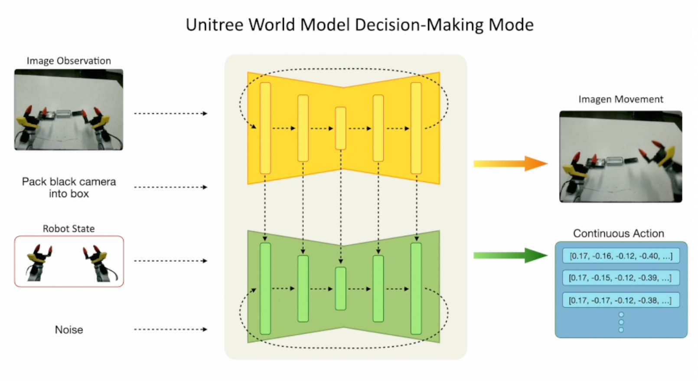
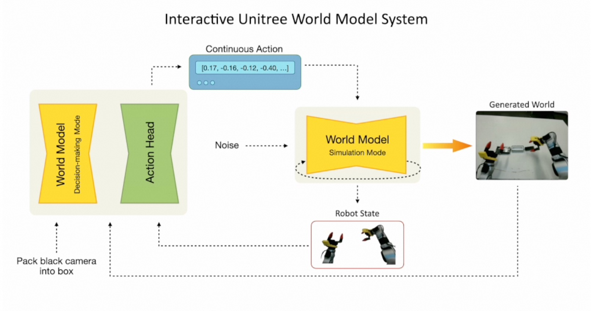

# UnifoLM-WMA 世界模型交互推理 — 学习笔记

2026 年 7 月，宇树科技发布了全模态家居康养智能体 UnifoLM-OmniA-0.3，在 G1 人形机器人上实现了感知、理解、决策、执行的完整闭环，但官方并未公布论文、模型权重或代码。

于是我找到了宇树已开源的世界模型 UnifoLM-WMA-0 进行本地测试。架构上，它把 Stable Diffusion 的视频生成范式扩展到“视频+动作”联合生成：Latent Video Diffusion UNet 生成视频，并联 Conditional 1D UNet 动作头生成关节角度序列，两者通过 DDIM 采样并行去噪。

核心能力：给定观测图像+文本指令，预测未来环境变化并输出动作序列。我测试的 Dual 模式同时运行决策模式（生成动作）和仿真模式（预测环境反馈），交替迭代形成闭环。

本地测试了 G1 装相机入盒、Z1 双臂收铅笔等任务，每个任务 11 轮自回归交互（约 6 分钟）。模型能生成连贯的任务视频和合理动作，长程 rollout 不崩溃，说明学到了物理交互因果规律。但视频分辨率和动作精度还有提升空间，这或许正是开源研究架构到产品级 OmniA-0.3 的差距。

> 第一次运行 UnifoLM-WMA-0-Dual 世界模型交互推理的学习记录。
> 本文解释输入数据、推理参数、输出结构，以及背后的核心概念。

---

## 0. 学习路径梳理

### 我本来想学什么？

**UnifoLM-OmniA-0.3**（宇树 2026.07 发布）—— 全模态家居康养智能体，在 G1 人形上实现感知→理解→决策→执行闭环。

### 为什么没学到？

- 无开源代码、无模型权重、无论文
- 纯产品发布公告（视频 demo + 社交媒体），GitHub/ModelScope/HuggingFace 均无资源

### 怎么找到了 WMA-0？

UnifoLM 是宇树的模型家族品牌，OmniA-0.3 是产品级集成，其底层核心组件已开源：

```
OmniA-0.3（产品级，未开源）
    │
    ├── UnifoLM-VLA-0（视觉-语言-动作，已开源）
    │
    └── UnifoLM-WMA-0（世界模型+动作，已开源）← 我们跑的
```

### 论文情况

| 模型 | 正式 arxiv 论文 | 替代资料 |
|------|------|------|
| UnifoLM-WMA-0 | ❌ 无 | GitHub README + Project Page |
| UnifoLM-VLA-0 | ❌ 无 | Project Page + ModelScope 模型卡 |
| UnifoLM-OmniA-0.3 | ❌ 无 | 产品发布视频 |

> 宇树偏工程/产品导向，不像学术机构那样发 paper。WMA-0 在综述中被引用为
> "Unitree (2025). UnifoLM-WMA-0: A world-model-action (WMA) framework under UnifoLM family"——这只是对代码仓库的引用。

### UnifoLM 家族全景

| 模型 | 定位 | 开源 |  backbone |
|------|------|------|------|
| UnifoLM-VLA-0 | 视觉-语言-动作，人形操作 | ✅ ModelScope | Qwen 2.5 VL 7B |
| UnifoLM-WMA-0 | 世界模型+动作，视频预测+决策 | ✅ GitHub+HF | Latent Diffusion (DiT) |
| UnifoLM-X1-0 | 工厂装配（G1 自组装） | ❌ | 未公开 |
| UnifoLM-OmniA-0.3 | 全模态家居康养智能体 | ❌ | 未公开 |
| UnifoLM-WBT-Dataset | 全身遥操作数据集 | ✅ HuggingFace | — |

---

## 1. 项目与模型

### 1.1 UnifoLM-WMA-0 是什么？

**UnifoLM-WMA**（World Model + Action）是宇树科技发布的具身智能基础模型，核心能力：

- **世界模型（World Model）**：给定当前观测图像 + 文本指令，预测未来环境变化的视频
- **动作生成（Action）**：同时输出机器人应执行的动作序列（关节角度/末端位姿）
- **Dual 模式**：同时生成视频预测（wm）和决策视频（dm），形成“想象→行动”闭环

模型架构基于 **Latent Diffusion**（潜空间扩散），在压缩的视频 latent 空间上做去噪生成。

### 1.2 代码仓库与模型权重的关系

```
┌─────────────────────────────────────────────────────┐
│  unifolm-world-model-action（代码仓库）               │
│  定义模型架构 + 训练/推理/部署流程                      │
│       ↓ 加载                                        │
│  UnifoLM-WMA-0-Dual（模型权重 .ckpt，~5GB）           │
│  在 5 个宇树开源数据集上微调得到的检查点                  │
└─────────────────────────────────────────────────────┘
```

简单说：**仓库是“引擎”，模型是“燃料”**。

| | 代码仓库 | 模型权重 |
|---|---|---|
| **是什么** | 模型架构定义 + 训练/推理/部署代码 | 训练好的参数文件（.ckpt） |
| **来源** | GitHub: `unitreerobotics/unifolm-world-model-action` | HuggingFace / ModelScope 下载 |
| **两个版本** | 同一套代码 | Base（Open-X 微调）/ Dual（宇树 5 数据集微调） |
| **我们用的** | fork + RTX 5090 适配修复 | `unifolm_wma_dual.ckpt` |

### 1.3 Base vs Dual 区别

| | UnifoLM-WMA-0_Base | UnifoLM-WMA-0_Dual |
|---|---|---|
| 训练数据 | Open-X 大规模跨本体数据集 | 宇树 5 个开源数据集（Z1/G1） |
| 能力 | 纯视频生成（图像+文本→预测未来视频） | 视频生成 + 动作序列（双模式） |
| 推理脚本 | `base_model_inference.py` | `world_model_interaction.py` |
| 适用场景 | 通用视频预测 | 机器人交互闭环（我们跑的） |

### 1.4 代码仓库结构

```
unifolm-world-model-action/
├── src/unifolm_wma/          # 核心源码
│   ├── models/               # 扩散模型、DDIM 采样器、Diffusion Policy Head
│   ├── modules/              # UNet、Attention、Encoder（CLIP/VAE）
│   ├── data/                 # 数据加载（LeRobot V2.1 格式）
│   └── utils/                # 工具函数
├── scripts/evaluation/       # 推理脚本
│   ├── base_model_inference.py       # Base 纯视频生成
│   ├── world_model_interaction.py    # Dual 交互推理（我们用的）
│   └── real_eval_server.py           # 真机部署服务
├── configs/inference/        # 推理配置 yaml
├── examples/                 # 示例数据（图像 + CSV + H5）
└── external/dlimp/           # 子模块（数据加载依赖）
```

### 1.5 世界模型的两大功能

| 功能 | 说明 |
|------|------|
| **Simulation Engine（仿真引擎）** | 作为交互式仿真器，生成合成数据用于机器人学习 |
| **Policy Enhancement（策略增强）** | 连接动作头，通过预测未来交互过程优化决策 |

### 1.6 模型架构详解

#### 总体结构图

```
┌─────────────────────── UnifoLM-WMA-0 ───────────────────────┐
│                                                              │
│  输入编码器 ℰ                                                │
│  ├── CLIP/SigLIP ViT  ← Image Observation（图像观测）       │
│  ├── MLPProjector     ← Language Instruction（语言指令）     │
│  └── State Encoder    ← Robot State（机器人状态）           │
│           │                                                  │
│           ▼                                                  │
│  ┌─── World Model（视频扩散 UNet）───┐                       │
│  │  • SpatialTransformer（空间注意力）│                       │
│  │  • TemporalTransformer（时间注意力）│  ← DDIM 去噪 k 步   │
│  │  • ResBlock + Timestep Embedding  │                       │
│  │  • TemporalConvBlock              │                       │
│  └───────────────────────────────────┘                       │
│           │                     │                            │
│           ▼                     ▼                            │
│     z_t (latent)         Action/State Head                   │
│           │              (Conditional UNet1D)                 │
│           ▼                     │                            │
│     VAE Decoder ℰ⁻¹            ▼                            │
│           │              Robot Actions / States               │
│           ▼                                                  │
│     Future Frames                                            │
└──────────────────────────────────────────────────────────────┘
```

#### 核心组件名词解释

| 组件 | 是什么 | 作用 |
|------|--------|------|
| **CLIP/SigLIP ViT** | 视觉-语言预训练模型（Vision Transformer）。CLIP 用图像-文本对比学习；SigLIP 是 Google 改进版，用 Sigmoid 损失替代 softmax | 将图像编码为语义特征向量，让模型“看懂”场景 |
| **MLPProjector** | 多层感知机投影层（Linear + GELU + Linear） | 将语言指令/机器人状态投影到与图像特征相同的维度空间，作为 cross-attention 的条件输入 |
| **State Encoder** | 机器人状态编码器（MLP + 位置编码） | 将关节角度、末端位姿等数值状态编码为模型可理解的嵌入向量 |
| **UNet** | U 形网络，编码器-解码器 + 跳跃连接。源自 Stable Diffusion 的图像生成架构 | 世界模型的主干网络，在 latent 空间做去噪生成视频 |
| **SpatialTransformer** | 空间注意力模块（Self-Attention + Cross-Attention + FFN） | 在每一帧内部做空间关系建模：“图像中哪个位置有什么” |
| **TemporalTransformer** | 时间注意力模块，在帧间做 Self-Attention | 建模帧间时间关系：“前一帧到后一帧怎么变化” |
| **ResBlock + Timestep Embedding** | 残差块 + 时间步嵌入。用正弦位置编码将扩散时间步 k 注入网络 | 告诉网络“当前去噪到第几步了”，控制去噪程度 |
| **TemporalConvBlock** | 时间维度 1D 卷积 + 残差连接 | 补充局部时间连续性（相邻帧的平滑过渡） |
| **z_t** | 时间步 t 的潜变量（latent variable），形状 [B, C, F, H/8, W/8] | 视频在 VAE 压缩空间的表示，去噪过程就是从纯噪声 z_T 逐步还原到干净 z_0 |
| **VAE Decoder ℰ⁻¹** | 变分自编码器解码器 | 将 latent z_0 解码回像素空间的视频帧 |
| **Action/State Head** | 条件 1D UNet（Conditional UNet1D） | 与 World Model 并行去噪，生成机器人动作序列或下一状态 |

#### 两种工作模式

**Decision-Making Mode（决策模式）**—— 我们推理跑的就是这个：



> 图解读：左侧 4 个输入（图像观测、语言指令“Pack black camera into box”、机器人状态、噪声）
> 进入中央的双层结构：黄色层 = World Model（生成未来视频），绿色层 = Action Head（生成动作）。
> 右侧输出：Imagen Movement（预测视频）+ Continuous Action（连续动作向量）。

```
输入：Image + Language + Robot State
  → World Model：在 latent 空间去噪 → 预测未来视频帧
  → Action Head：并行去噪 → 输出动作序列 [0.17, -0.15, -0.39, ...]
```

**Simulation Mode（仿真模式）**：

```
输入：Image + Robot State + Robot Actions + Noise
  → World Model：给定动作，预测执行后的未来帧
  → State Head：预测执行后的机器人状态
```

区别：决策模式是“给目标→生成动作”，仿真模式是“给动作→预测结果”。

#### 自回归交互闭环：输入输出如何衔接

这是我们跑的 12 步交互推理的核心逻辑：



> 图解读：这是完整的交互系统闭环。
> 1. 左侧：World Model（决策模式）+ Action Head → 输出 Continuous Action
> 2. 中间：Continuous Action 输入 World Model（仿真模式）+ Noise
> 3. 右侧：仿真模式输出 Generated World（环境变化视频）+ Robot State
> 4. 底部反馈：Generated World 和 Robot State 通过虚线箭头反馈回决策模式，形成闭环
>
> 这正是我们跑的 12 步交互的本质：每一步的输出成为下一步的输入。

```
初始输入（来自 H5 文件）：
  • 第一帧图像（0.png）
  • 初始机器人状态（关节角度）

═══ 第 1 轮迭代 ═══

  Step A：决策模式（DM）
  ┌─────────────────────────────────────────┐
  │ 输入：当前图像 + 语言指令 + 机器人状态  │
  │ 输出：pred_actions（动作序列）          │
  │       pred_videos_0（DM 视角未来帧）    │
  └─────────────────────────────────────────┘
           │
           │ pred_actions 作为下一步的输入
           ▼
  Step B：仿真模式（Sim）
  ┌─────────────────────────────────────────┐
  │ 输入：当前图像 + pred_actions + 状态    │
  │ 输出：pred_videos_1（环境变化视频）      │
  │       pred_states（下一时刻机器人状态）  │
  └─────────────────────────────────────────┘
           │
           │ pred_videos_1 + pred_states
           │ 成为下一轮的“当前图像”和“当前状态”
           ▼
═══ 第 2 轮迭代 ═══
  ...（重复 Step A → Step B）

═══ 第 N 轮迭代 ═══
  ...直到 n_iter 步用完
```

**简单说：**
- 模型的输入 = 上一轮仿真模式输出的未来帧 + 状态
- 模型的输出 = 动作（发给机器人执行）+ 未来视频（反馈为下一轮输入）
- 形成 **“观测→决策→执行→新观测”** 的闭环

#### 对应代码位置

| 组件 | 代码文件 |
|------|----------|
| 视频扩散 UNet | `modules/networks/wma_model.py` → `WMAModel` |
| Latent Diffusion 封装 | `models/ddpms.py`（源自 Stable Diffusion 代码） |
| VAE 编解码器 | `models/autoencoder.py` |
| DDIM 采样器 | `models/samplers/ddim.py` |
| Action/State Head | `models/diffusion_head/conditional_unet1d.py` |
| 视觉编码器 | `modules/vision/dinosiglip_vit.py` |
| 条件投影 | `modules/encoders/condition.py` → `MLPProjector` |
| 注意力模块 | `modules/attention.py`（Spatial + Temporal Transformer） |
| 自回归闭环 | `scripts/evaluation/world_model_interaction.py` L552-641 |

#### 架构图来源

仓库内有两张官方架构图（`assets/pngs/`）：
- `dm_mode.png`：Decision-Making Mode 数据流
- `sim_mode.png`：Simulation Mode 数据流

Project Page 有更完整的可视化：https://unigen-x.github.io/unifolm-world-model-action.github.io

> 一句话总结：WMA-0 = **Latent Video Diffusion UNet**（世界模型，预测未来视频）
> + **Conditional 1D UNet**（动作头，生成机器人动作），
> 两者共享编码条件、并行去噪，通过 DDIM 采样在 latent 空间联合生成。
> 本质上是把 Stable Diffusion 的图像生成范式扩展到了**视频+动作**的联合生成。

### 1.7 训练流程（三步走）

| 步骤 | 做什么 | 数据 | 结果 |
|------|--------|------|------|
| **Step 1** | 微调视频生成模型 → 世界模型 | Open-X 大规模跨本体数据集 | 通用视频生成能力适配到机器人场景 |
| **Step 2** | 训练决策模式（DM） | 下游任务数据集 | 世界模型预测未来交互 → 辅助 Action Head 生成动作 |
| **Step 3** | 训练仿真模式（Sim） | 下游任务数据集 | 给定动作序列 → 生成高保真环境反馈视频 |

> Step 1 的产物 = `UnifoLM-WMA-0_Base`（纯视频生成）
> Step 1+2+3 的产物 = `UnifoLM-WMA-0_Dual`（双模式，我们用的）

双模式架构的核心设计：**同一个世界模型可以切换两种运行模式**：
- 决策模式：世界模型提供未来交互的预测信息给 Action Head
- 仿真模式：世界模型接收动作序列，输出对应的视觉观测（“想象”执行结果）

### 1.8 演示能力与关键观察

官方 Project Page 展示了 4 个任务 × 5 个数据集的三类能力：

#### 任务列表

| 任务 | 机器人 | 说明 |
|------|--------|------|
| Z1 单臂叠盒子 | Unitree Z1 | 红黄绿积木堆叠 |
| Z1 双臂叠盒子 | Unitree Z1 × 2 | 双臂协作堆叠 |
| Z1 双臂收橡皮和铅笔 | Unitree Z1 × 2 | 双臂清理桌面 |
| G1 装黑色相机入盒 | Unitree G1 | 人形机器人精细操作 |

#### 三类演示能力

| 能力 | 说明 | 对应我们的输出 |
|------|------|------|
| **真机部署** | 4 个任务的真机执行视频，右上角小窗 = 世界模型对未来动作的预测 | `wm/` 目录 |
| **动作可控生成（短期）** | 给模型当前图像 + N 个未来动作，生成对应视觉结果（8步 vs 16步对比） | 单轮 dm+wm |
| **持续交互生成（长程）** | 世界模型 rollout 整个任务，不只是预测几步 | 11 轮迭代 = `0_full_fs6.mp4` |

#### 关键观察

- 世界模型嵌入策略架构中，不是独立运行的视频生成器，而是**策略的“想象力”组件**
- 同一个模型既能“想象未来”（DM）又能“模拟执行”（Sim），两个角色无缝切换
- 长程 rollout 能力说明模型学到了物理交互的因果规律，而不是简单的视频外推

---

## 2. 输入数据

示例数据位于 `examples/world_model_interaction_prompts/`：

```
world_model_interaction_prompts/
├── unitree_z1_stackbox.csv          # 数据集描述文件
├── images/
│   └── unitree_z1_stackbox/
│       └── 0.png                    # 初始观测图像（第一帧）
└── transitions/
    └── unitree_z1_stackbox/
        ├── 0.h5                     # 动作/状态归一化统计量
        └── meta_data                # 元数据
```

### CSV 文件字段

| 字段 | 含义 | 示例 |
|------|------|------|
| `videoid` | 样本 ID | `0` |
| `data_dir` | 数据集子目录名 | `unitree_z1_stackbox` |
| `instruction` | 自然语言任务指令 | "Stack the blocks: red at bottom, yellow middle, green on top." |
| `embodiment` | 机器人本体类型 | `Unitree Z1 Robot Arm` |
| `fps` | 原始数据帧率 | `30` |

### 初始图像

`images/{dataset}/{videoid}.png` — 机器人摄像头的初始观测帧，作为世界模型生成的起点。

### H5 文件

`transitions/{dataset}/{videoid}.h5` — 包含该数据集的动作/状态归一化参数（min/max），
用于将模型输出的归一化动作反归一化为真实关节值。

---

## 3. 推理参数详解

```bash
CUDA_VISIBLE_DEVICES=0 python3 scripts/evaluation/world_model_interaction.py \
    --seed 123 \
    --ckpt_path <模型权重路径> \
    --config configs/inference/world_model_interaction.yaml \
    --savedir <输出目录> \
    --bs 1 --height 320 --width 512 \
    --unconditional_guidance_scale 1.0 \
    --ddim_steps 50 --ddim_eta 1.0 \
    --prompt_dir examples/world_model_interaction_prompts \
    --dataset unitree_z1_stackbox \
    --video_length 16 --frame_stride 2 \
    --n_action_steps 16 --exe_steps 16 \
    --n_iter 12 \
    --timestep_spacing uniform_trailing \
    --guidance_rescale 0.7 \
    --perframe_ae
```

### 参数分类

#### 基础配置

| 参数 | 值 | 含义 |
|------|-----|------|
| `--seed` | 123 | 随机种子，保证可复现 |
| `--ckpt_path` | `.ckpt` | 模型权重文件（~5GB） |
| `--config` | `.yaml` | 模型结构配置（UNet、VAE、CLIP 等） |
| `--savedir` | 路径 | 输出保存目录 |
| `--prompt_dir` | 路径 | 输入数据目录（图像+CSV+H5） |
| `--dataset` | 名称 | 选择哪个数据集的样本 |

#### 生成分辨率

| 参数 | 值 | 含义 |
|------|-----|------|
| `--bs` | 1 | batch size（必须为 1） |
| `--height` | 320 | 生成视频帧高度（像素） |
| `--width` | 512 | 生成视频帧宽度（像素） |

#### 扩散采样参数

| 参数 | 值 | 含义 |
|------|-----|------|
| `--ddim_steps` | 50 | DDIM 去噪步数（越多越精细，越慢） |
| `--ddim_eta` | 1.0 | 随机性系数（0=确定性，1=最大随机） |
| `--unconditional_guidance_scale` | 1.0 | CFG 引导强度（1.0=不使用分类器引导） |
| `--timestep_spacing` | uniform_trailing | 时间步采样策略（尾部均匀分布） |
| `--guidance_rescale` | 0.7 | 引导重缩放因子（防止过饱和） |

#### 视频与动作参数

| 参数 | 值 | 含义 |
|------|-----|------|
| `--video_length` | 16 | 每次生成的视频帧数 |
| `--frame_stride` | 2 | 帧间隔（越大→动作幅度越大） |
| `--n_action_steps` | 16 | 每次生成的动作步数 |
| `--exe_steps` | 16 | 实际执行（反馈回模型）的步数 |
| `--n_iter` | 12 | 自回归迭代次数（总共生成 n_iter × exe_steps 帧） |

#### 显存优化

| 参数 | 值 | 含义 |
|------|-----|------|
| `--perframe_ae` | flag | 逐帧解码 VAE（降低显存峰值，推荐开启） |

---

## 4. 推理流程（Pipeline）

```
┌─────────────────────────────────────────────────────────────┐
│                    自回归交互循环 (n_iter 次)                  │
│                                                             │
│  ┌──────────┐    ┌──────────────┐    ┌──────────────────┐  │
│  │ 初始图像  │───▶│  World Model │───▶│ 预测未来16帧视频  │  │
│  │ + 指令   │    │  (扩散生成)   │    │ + 动作序列       │  │
│  └──────────┘    └──────────────┘    └────────┬─────────┘  │
│       ▲                                       │            │
│       │         ┌──────────────┐              │            │
│       └─────────│ 取最后帧作为  │◀─────────────┘            │
│                 │ 下一轮输入    │                           │
│                 └──────────────┘                           │
└─────────────────────────────────────────────────────────────┘
```

每次迭代的详细步骤：

1. **编码**：将当前观测图像通过 VAE 编码到 latent 空间
2. **条件注入**：CLIP 编码文本指令 + 图像条件
3. **DDIM 采样**：在 latent 空间做 50 步去噪，生成 16 帧视频 latent
4. **解码**：VAE 解码 latent → RGB 视频帧
5. **动作提取**：Diffusion Policy Head 从中间特征提取 16 步动作
6. **状态预测**：同时预测机器人状态（关节角等）
7. **反馈**：取生成视频的最后帧作为下一轮的观测输入

---

## 5. 输出结构详解

```
outputs/interaction/
├── inference/
│   ├── 0_full_fs2.mp4                    # ① 完整 rollout 视频
│   └── sample_0/
│       ├── wm/2/                         # ② World Model 输出
│       │   ├── itr-0.mp4                 #    第 0 次迭代
│       │   ├── itr-1.mp4                 #    第 1 次迭代
│       │   ├── ...
│       │   └── itr-11.mp4               #    第 11 次迭代
│       └── dm/2/                         # ③ Decision Making 输出
│           ├── itr-0.mp4
│           ├── ...
│           └── itr-11.mp4
└── tensorboard/
    └── events.out.tfevents.*             # ④ TensorBoard 日志
```

### 各输出含义

| 输出 | 路径模式 | 含义 |
|------|----------|------|
| **完整视频** | `{videoid}_full_fs{stride}.mp4` | 所有迭代的 wm 视频首尾拼接，展示完整任务执行过程 |
| **wm 视频** | `sample_{id}/wm/{stride}/itr-{n}.mp4` | 第 n 次迭代中，世界模型预测的环境变化（"想象的未来"） |
| **dm 视频** | `sample_{id}/dm/{stride}/itr-{n}.mp4` | 第 n 次迭代中，决策模块生成的动作对应的视频（"决策依据"） |
| **TensorBoard** | `tensorboard/events.*` | 可用 `tensorboard --logdir` 查看视频和指标 |

### 输出产物与架构图的对应关系

以 `unitree_g1_pack_camera` 的实际输出为例：

#### 对应图 1（wm-descision-making.jpg）—— 决策模式

| 图中元素 | 对应输出文件 |
|----------|-------------|
| **Imagen Movement**（右侧预测视频） | `dm/6/itr-*.mp4` |
| **Continuous Action**（右侧动作向量） | 不单独保存，内部传递给 wm 作为输入 |
| 左侧 Image Observation | 上一轮 wm 输出的最后一帧（或初始 0.png） |
| 左侧 "Pack black camera into box" | CSV 中的 instruction 字段 |

#### 对应图 2（wms.jpg）—— 完整交互系统

| 图中元素 | 对应输出/数据 |
|----------|-------------|
| **World Model (Decision-making Mode)** | `dm/` 目录（每轮生成一段视频） |
| **Continuous Action** | dm 生成的动作序列（内部传递，不保存） |
| **World Model (Simulation Mode)** | `wm/` 目录（每轮生成一段视频） |
| **Generated World**（右侧环境视频） | `wm/6/itr-*.mp4` |
| **Robot State**（右下机器人状态） | 内部状态向量（反馈回下一轮，不单独保存） |
| **底部反馈虚线箭头** | itr-N 的 wm 输出 → itr-(N+1) 的 dm 输入 |
| **0_full_fs6.mp4** | 所有轮次的完整拼接总览 |

#### 一轮迭代的数据流（对应图 2）

```
itr-0:
  dm/6/itr-0.mp4  ← 决策模式：“看到初始画面，想象怎么把相机装进盒子”
       │
       │ 动作序列（不保存）
       ▼
  wm/6/itr-0.mp4  ← 仿真模式：“执行这些动作后，世界变成什么样”
       │
       │ 最后一帧 + 状态（反馈）
       ▼
itr-1:
  dm/6/itr-1.mp4  ← 决策模式：基于 itr-0 wm 的结果，继续决策
       ...
```

**简单说：**
- `dm/` = 图 1 的产物（“机器人想象中自己在动”）
- `wm/` = 图 2 右侧 "Generated World" 的产物（“执行动作后环境的变化”）
- 两者交替生成 11 轮，就是图 2 中那个闭环跑了 11 圈

### 文件命名规则

- `fs2` / `fs4` / `fs6`：frame_stride 值，表示帧间隔
- `itr-{n}`：第 n 次自回归迭代（0-indexed）
- `sample_{id}`：对应 CSV 中的 videoid

### 视频内容

每个 `itr-{n}.mp4` 包含 **16 帧**（由 `--video_length 16` 决定），
以 8fps 保存（`--save_fps` 默认值），时长约 2 秒。

完整视频 `0_full_fs2.mp4` = 12 次迭代 × 16 帧 = **192 帧**，约 24 秒。

---

## 6. 核心概念

### 6.1 Latent 空间（潜空间）与 Latent Diffusion

#### 什么是 Latent 空间？

> Latent 空间 = 图像的**压缩摘要空间**。把 256×256 的像素图“浓缩”成 32×32 的特征图，
> 在这个小空间里做计算，最后再“展开”回像素。

```
原始图像（像素空间）          Latent 空间（压缩空间）
┌──────────────────┐         ┌────────┐
│ 256 × 256 × 3   │  VAE    │ 32×32×4│  ← 体积缩小 64 倍
│ = 196,608 个数值 │ ──编码──▶│ = 4,096│
│                  │         │  个数值 │
│ 每个像素一个颜色 │         │ 每个位置│
│ 信息冗余极大     │         │ 是“语义”│
└──────────────────┘         └────────┘
                                    │
                              在这里做扩散
                              （去噪生成）
                                    │
                                    ▼
                             ┌──────────────────┐
                             │ VAE 解码 → 视频帧 │
                             └──────────────────┘
```

#### 为什么不直接在像素空间做？

| | 像素空间 | Latent 空间 |
|---|---|---|
| 数据量 | 256×256×3×16帧 = 300万+ | 32×32×4×16帧 = 6.5万 |
| 计算量 | 极大（UNet 跑不动） | 缩小 ~64 倍 |
| 信息质量 | 大量冗余（相邻像素几乎一样） | 保留语义（“这里有机械臂”） |
| 生成质量 | 容易模糊 | 更清晰（Stable Diffusion 的核心创新） |

#### 类比理解

把 latent 空间想象成**文章的摘要**：
- 像素空间 = 一篇 10 万字的原文（信息完整但冗余）
- Latent 空间 = 500 字的摘要（核心语义都在，体积小）
- VAE Encoder = 写摘要的人
- VAE Decoder = 从摘要还原原文的人
- 扩散模型 = 在摘要层面“创作”新内容，比直接在原文上改高效得多

#### Latent Diffusion 的完整流程

```
训练时：
  真实视频 → VAE Encode → z_0 → 加噪声 → z_t → UNet 预测噪声 → 计算 loss

推理时：
  纯噪声 z_T → UNet 去噪 × k 步 → 干净 z_0 → VAE Decode → 未来视频帧
```

### 6.2 扩散时间步 t 与 z_t

#### t 是什么？

**t = 噪声程度**，范围 0 ~ 1000（配置中 `timesteps: 1000`）：

| t 值 | 含义 | z_t 的样子 |
|------|------|------|
| t = 0 | 完全干净，无噪声 | 清晰的视频 latent |
| t = 500 | 加了一半噪声 | 隐约能看出轮廓 |
| t = 1000 (T) | 纯高斯噪声，最大噪声 | 完全随机，看不出任何内容 |

```
前向过程（加噪，训练用）：
z_0 ──加噪──▶ z_1 ──▶ z_2 ──▶ ... ──▶ z_1000（纯噪声）

反向过程（去噪，推理用）：
z_1000 ──去噪──▶ z_999 ──▶ ... ──▶ z_1 ──▶ z_0（干净 latent）
```

#### 1000 是哪来的？

- 这是**人为设定的超参数**，不是物理意义
- 配置文件中 `timesteps: 1000` 定义了噪声调度的总步数
- 每一步加多少噪声由 `beta_schedule`（`linear_start: 0.00085`, `linear_end: 0.012`）控制
- 训练时随机抽取 t ∈ [0, 1000]，让 UNet 学会在任意噪声程度下去噪

#### DDIM 加速：1000 步 → 50 步

训练时用 1000 步定义噪声调度，但推理时不需要每步都走：

```
训练：定义了 1000 个时间步的噪声调度表
推理：DDIM 只取其中 50 个关键步（--ddim_steps 50）

即：z_1000 → z_980 → z_960 → ... → z_20 → z_0
    （跳过中间步，每步“多去一点噪声”）
```

这就是为什么 `--ddim_steps 50` 就能生成质量不错的视频，而不需要真的去噪 1000 次。

#### z_t 在 WMA-0 中的具体形状

```
z_t: [batch=1, channels=4, frames=16, h=32, w=32]

• batch=1：一次生成一个样本
• channels=4：VAE 压缩后的通道数（原始 RGB 3通道 → latent 4通道）
• frames=16：一次生成 16 帧视频
• h=32, w=32：原始 256×256 图像经 VAE 8倍下采样后 = 32×32
```

### 6.3 Classifier-Free Guidance (CFG)

`--unconditional_guidance_scale 1.0` 表示不使用 CFG：
- CFG > 1 时：`output = uncond + scale × (cond - uncond)`
- 本模型使用 `guidance_rescale=0.7` 做引导重缩放，防止过饱和

### 6.4 World Model vs Decision Making

| | World Model (wm) | Decision Making (dm) |
|---|---|---|
| 作用 | 预测环境未来状态 | 生成机器人动作 |
| 输入 | 当前观测 + 指令 | 当前观测 + 指令 |
| 输出 | 未来视频帧 | 动作序列 + 状态预测 |
| 关系 | 提供"想象"供决策参考 | 基于想象做出行动 |

### 6.5 自回归交互

模型不是一次性生成整段视频，而是：
1. 生成 16 帧 → 取最后帧
2. 将最后帧作为新的观测 → 再生成 16 帧
3. 重复 n_iter 次

这样每一步都基于上一步的预测结果，形成**闭环交互**。

---

## 7. 数据集对照表

| 数据集 | 机器人 | 任务 | n_iter | frame_stride |
|--------|--------|------|--------|-------------|
| unitree_z1_stackbox | Z1 单臂 | 积木堆叠（红黄绿） | 12 | 2 |
| unitree_z1_dual_arm_stackbox | Z1 双臂 | 积木堆叠 | 7 | 4 |
| unitree_z1_dual_arm_stackbox_v2 | Z1 双臂 | 积木堆叠 v2 | 11 | 4 |
| unitree_z1_dual_arm_cleanup_pencils | Z1 双臂 | 收拾铅笔 | 8 | 4 |
| unitree_g1_pack_camera | G1 人形 | 包装相机 | 11 | 6 |

---

## 8. 性能参考

| 指标 | 数值 |
|------|------|
| GPU | RTX 5090 (32GB VRAM) |
| 每次迭代耗时 | ~33 秒 |
| 总耗时（12 步） | ~6 分 40 秒 |
| 显存占用 | ~20GB（perframe_ae 开启） |
| 输出大小 | ~60MB（35 个 mp4 文件） |

---

## 9. 查看结果

```bash
# 直接播放完整视频
mpv /home/creator/ws/104-unitreerobotics/outputs/interaction/inference/0_full_fs2.mp4

# 或用 TensorBoard 查看所有迭代
tensorboard --logdir /home/creator/ws/104-unitreerobotics/outputs/interaction/tensorboard --port 6006
```

---

## 10. UnifoLM-WMA-0 与 UnifoLM-OmniA-0.3 的关系

### 时间线

| 模型 | 发布时间 | 开源状态 |
|------|----------|----------|
| UnifoLM-WMA-0-Dual | 2025 年 9 月 | ✅ 已开源（GitHub + ModelScope） |
| UnifoLM-OmniA-0.3 | 2026 年 7 月 20 日 | ❌ 未开源（无代码、无权重） |

### 定位对比

| | UnifoLM-WMA-0 | UnifoLM-OmniA-0.3 |
|---|---|---|
| **全称** | World Model + Action | Omni-Agent（全能智能体） |
| **定位** | 开源研究架构 | 产品级应用模型 |
| **核心能力** | 世界模型视频预测 + 动作生成 | 全模态交互理解 + 自主任务执行 |
| **任务范围** | 单一操作任务（积木堆叠、收拾铅笔等） | 多任务统筹（家居、康养、设备控制） |
| **交互方式** | 图像 + 文本指令 | 视觉识别、语言对话、精细操作、设备控制 |
| **运行平台** | Z1 机械臂 / G1 人形 | G1 人形机器人 |
| **架构** | Latent Diffusion + Diffusion Policy Head | 未公开（推测为 WMA 的进化版本） |

### 技术演进关系

```
UnifoLM-WMA-0 (2025.09, 开源)
│
│  • 世界模型：给定观测+指令，预测未来视频
│  • 动作头：同时输出机器人动作序列
│  • 自回归交互：多步迭代生成
│
▼
UnifoLM-OmniA-0.3 (2026.07, 未开源)
│
│  • 全模态理解：视觉 + 语言 + 触觉(?)
│  • 多任务统筹：单模型处理家居/康养多类任务
│  • 全程自主：无需人工干预，抗干扰稳定执行
│  • 闭环控制：感知 → 理解 → 决策 → 执行
│
▼
未来开源版本（待宇树发布）
```

### OmniA-0.3 展示的任务示例

- 物品搬运：将地上的抱枕放到沙发上
- 视觉识别与回答：识别抱枕颜色、药盒颜色和数量
- 精细操作：将第三层蓝色药盒拿到上面来、把衣服放进脏衣篓、将盘子放入洗碗机
- 设备控制：调节病床高度，用户说“停”时立即停止

### 当前状态

> **需要区分 UnifoLM 体系下的不同组件：**
>
> **已开源：UnifoLM-WMA（World Model Action）**
> - GitHub: [unitreerobotics/unifolm-world-model-action](https://github.com/unitreerobotics/unifolm-world-model-action)
> - README 明确写了 "released the training and inference code along with the model weights"
> - 提供 UnifoLM-WMA-0_Base 和 UnifoLM-WMA-0_Dual 两个检查点（HuggingFace / ModelScope 下载）
> - 包含训练、推理和真机部署的完整代码
>
> **未开源：UnifoLM-OmniA-0.3 整体模型**
> - 截至 2026 年 7 月，未看到模型权重开源或 HuggingFace 下载链接
> - 更多是以产品发布的形式对外公布，强调在宇树自家机器人上的落地能力
> - GitHub / ModelScope / HuggingFace 均无相关仓库
>
> 简单说：**WMA 组件已开源可下载，OmniA-0.3 整体模型目前还没有开源。**
>
> 关注后续动态可留意：
> - 宇树 GitHub 组织：https://github.com/unitreerobotics
> - 宇树官网：https://unifolm.com

### 学习建议

当前可学习的开源资源仍然是 **UnifoLM-WMA-0**：
- 它代表了宇树世界模型 + 动作生成的核心技术路线
- OmniA-0.3 很可能在其基础上增加了多模态理解、任务规划、实时控制等能力
- 理解 WMA 的架构（Latent Diffusion + Diffusion Policy + 自回归交互）是理解后续演进的基础

---

## 11. WMA-0 与 VLA-0 的关系：“下半身”与“上半身”

### 一句话理解

| | VLA-0（上半身/大脑） | WMA-0（下半身/小脑） |
|---|---|---|
| **解决什么问题** | “做什么”（What to do） | “怎么做”（How to do it） |
| **输入** | 图像 + 语言指令 | 当前观测 + 任务目标 |
| **输出** | 高层决策 / 动作序列 | 未来视频预测 + 精细动作轨迹 |
| **backbone** | VLM（Qwen 2.5 VL 7B） | 视频生成模型（Latent Diffusion） |
| **类比** | 大脑皮层：看懂场景、理解指令、规划任务 | 小脑+运动皮层：运动想象、轨迹优化、精细执行 |

### 更直观的比喻

```
人类拿杯子喝水：

  VLA（大脑）：“我看到桌上有个红色杯子，用户说‘帮我拿水’”
       │
       │  下发任务目标：“拿起红色杯子”
       ▼
  WMA（小脑）：“我想象手伸向杯子的过程…第1帧…第2帧…第3帧…”
       │
       │  输出关节角度序列
       ▼
  机器人执行
```

### 技术路线对比

当前具身智能领域有两大主流技术路线（参考 NVIDIA 2026 年 WAM 综述博客）：

| | VLA 路线 | WAM/WMA 路线 |
|---|---|---|
| **起点** | 从 VLM（视觉语言模型）出发 | 从视频生成模型出发 |
| **核心假设** | 语言理解能力可以迁移到动作生成 | 预测未来世界变化的能力等价于生成动作 |
| **代表** | Pi-0、GR00T N1、UnifoLM-VLA-0 | UniPi、DreamZero、UnifoLM-WMA-0 |
| **优势** | 语言理解强、零样本泛化好 | 物理直觉强、动作连贯性好 |
| **劣势** | “接地差距”：语言知识难转化为精确运动 | 语言理解能力弱于 VLM |

### 它们如何协作？（推测 OmniA-0.3 的架构）

```
┌─────────────────────────────────────────────┐
│           OmniA-0.3（产品级集成）           │
├─────────────────────────────────────────────┤
│                                             │
│  ┌─────────────┐       ┌─────────────┐  │
│  │  VLA-0      │       │  WMA-0      │  │
│  │  (大脑)     │──────▶│  (小脑)     │  │
│  │             │ 任务  │             │  │
│  │ • 视觉理解  │ 目标  │ • 视频预测  │  │
│  │ • 语言对话  │       │ • 动作生成  │  │
│  │ • 任务规划  │◀──────│ • 轨迹优化  │  │
│  │ • 设备控制  │ 反馈  │ • 自回归    │  │
│  └─────────────┘       └─────────────┘  │
│         │                     │           │
│         ▼                     ▼           │
│  ┌─────────────────────────────────┐  │
│  │     实时控制层（全身运动控制）     │  │
│  └─────────────────────────────────┘  │
└─────────────────────────────────────────────┘
```

交互流程：
1. **VLA 感知理解**：看到场景 + 听到指令 → 理解任务 → 生成高层规划
2. **WMA 运动想象**：接收任务目标 + 当前观测 → 在潜空间“想象”未来 N 帧 → 同时输出动作序列
3. **闭环迭代**：WMA 的预测结果反馈给 VLA 确认，或用于自回归下一步生成
4. **执行**：动作序列下发到机器人关节控制器

### 为什么说 WMA 是“下半身”？

- VLA 解决的是 **认知层** 问题：看懂世界、理解语言、决定做什么
- WMA 解决的是 **运动层** 问题：给定目标后，具体怎么动、动多快、轨迹如何优化
- 就像人类：大脑决定“我要拿那个杯子”，小脑和运动皮层负责规划具体的肌肉协调和轨迹

### 当前学习价值

| 学 WMA-0 能理解什么 | 对应 OmniA-0.3 的哪部分 |
|---|---|
| Latent Diffusion 视频生成 | 世界模型的“想象”能力 |
| DDIM 采样 + 自回归交互 | 多步运动规划与执行 |
| Diffusion Policy Head | 精细动作生成 |
| CLIP/VAE 编码器 | 视觉观测压缩与理解 |
| CFG（Classifier-Free Guidance） | 任务条件引导 |

> 参考：NVIDIA 技术博客 "Pretrained to Imagine, Fine-Tuned to Act: The Rise of World-Action Models" (2026)
> 核心观点：未来赢家很可能既不是纯 VLA 也不是纯 WAM，而是两者的混合体——这正是 OmniA-0.3 的方向。
