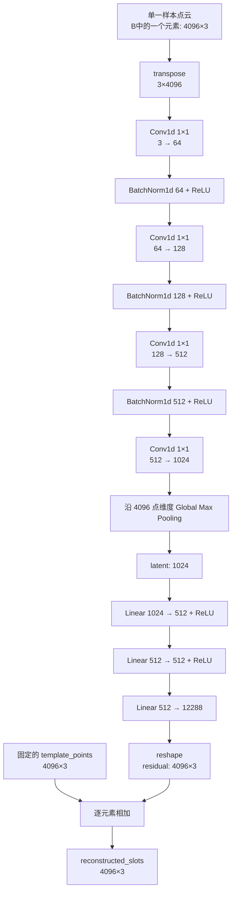
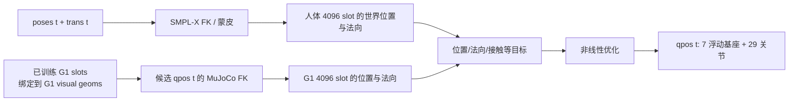

# PointNetTemplateResidualAE 网络设计、训练与推理解读

> 版本 v1.1 · 2026-09-13 · 对应源码：[train_correspondence_template_residual_ae.py](../UMR/scripts/train_correspondence_template_residual_ae.py)
>
> 阅读前建议先看：[01-UMR安装部署指南-v1.0.md](01-UMR安装部署指南-v1.0.md) 了解完整流水线，再看：[02-UMR技术链路与数据流解读-v1.0.md](02-UMR技术链路与数据流解读-v1.0.md) 了解人体动作如何最终变成 G1 `qpos`。本文只聚焦其中的离线点云对应网络 `PointNetTemplateResidualAE`。

---

## 〇、它在 UMR 中解决什么问题

人体和 G1 的关节数、肢体比例和网格顶点数均不同，无法直接按“第 i 个关节/顶点”配对。UMR 因此先在静态参考姿态下学习一套共享的表面编号：

```text
人体 canonical 表面点云（4096 点）          G1 T-pose 外表面点云（4096 点）
                │                                      │
                └──── PointNetTemplateResidualAE ──────┘
                                      │
                                      ▼
人体 slot #0 ↔ G1 slot #0
人体 slot #1 ↔ G1 slot #1
... 
人体 slot #4095 ↔ G1 slot #4095
```

这里的 `slot` 可以理解为“表面语义标记点的编号”。它不是原始网格顶点 id，也不是人工标注的“左膝/右手”标签；它是网络从形状覆盖、点间分散和表面拓扑约束中学出的共享顺序。

网络只在阶段①离线运行一次。之后重定向任意跳舞动作时，不再调用该网络做逐帧推理，而是读取训练导出的 `correspondence_slots_final.npz`，将其中的 slot 绑定回人体和机器人表面，作为逐帧优化的目标。

### 先记住三种坐标：避免把训练内部结果和最终产物混为一谈

本文后续会反复出现同为 `(4096,3)` 的数组；它们的 shape 相同，但坐标含义不同：

```text
① 原始/真实坐标 raw_points
   采样自人体或 G1 mesh，单位是米；写入数据集 npz 的 points。

② 训练归一化坐标 dataset.points / 网络内部 template_points / recon
   各自除以本样本身高；网络、loss 和 residual 都在此坐标空间中计算。

③ 导出真实坐标 reconstructed_slots
   将网络内部 recon 乘回各自 normalization_scale；下游重定向读取此字段，单位恢复为米。
```

因此，源码变量 `recon` 是**训练时、归一化坐标空间中的网络输出**；文件字段 `reconstructed_slots` 才是反归一化后的最终产物。后文所有涉及 `template_points`、`residual`、loss 和 `.npz` 的段落均以此区分为准。

---

## 一、先建立正确的整体认知

### 1.1 它是什么、又不是什么

| 问题 | 答案 |
|------|------|
| 是 RNN / LSTM 吗？ | 不是。它没有循环状态，也不处理时间序列。 |
| 是 Transformer 吗？ | 不是。没有 attention、token 序列或位置编码。 |
| 是 CNN 吗？ | Encoder 使用 `Conv1d(kernel_size=1)`，可视为点云上的逐点 1D CNN。 |
| 是 MLP 吗？ | Decoder 是 MLP；整个网络是 PointNet 风格 Encoder + MLP Decoder。 |
| 它直接输出 G1 的关节角吗？ | 不输出。它输出表面对应 slot；关节角由后续 `retarget_smpl_to_humanoid_surface_vector.py` 优化求解。 |
| 它在本例中学习跳舞的 3945 帧吗？ | 不学习。训练只使用“静态人体 canonical 点云 + 静态 G1 T-pose 点云”两组样本。 |

### 1.2 为什么叫“模板残差自编码器”

名称拆开看：

- **PointNet**：输入是一堆没有固定顺序的点；对每个点用共享 `1×1 Conv` 提取特征，再用 max pooling 汇总为整个形状的特征；
- **Template**：固定选择一份已排序的人体 4096 点作为共同模板 `template_points`；
- **Residual**：网络不直接从零生成点坐标，而是预测每个 template 点应偏移多少；
- **Autoencoder**：点云经 Encoder 压缩为全局 latent，再经 Decoder 重建出覆盖输入表面的 slot 点云。

其核心公式为：

```text
reconstructed_slots = template_points + residual_slots
```

人体和机器人都从同一份 `template_points` 出发输出 4096 个有固定下标的点，因此下标本身成为对应关系的载体。

---

## 二、训练前准备了什么数据

### 2.1 本机 Quick Start 的两个静态样本

Quick Start 先执行 `build_correspondence_ae_dataset.py`，输出：

```text
data/correspondence_unitree_g1_smplx_neutral_betas_c4eb7419e9.npz
```

其中本次只有两组样本：

| batch 索引 | 名称 | 来自哪里 | 原始网格 | 点云形状 |
|---:|---|---|---|---|
| 0 | `smplx_neutral_betas_c4eb7419e9` | `SMPLX_NEUTRAL.pkl` + 跳舞序列的 `betas` | 10475 顶点、20908 三角面 | `(4096,3)` |
| 1 | `unitree_g1` | `assets/g1/g1_29dof.xml` + G1 视觉 mesh + T-pose | 192938 顶点、385626 三角面 | `(4096,3)` |

这两组 4096 点不是直接从网格顶点中截取的。构建脚本在三角面内按面积随机采样候选点，再以 FPS（Farthest Point Sampling）保留均匀分散的 4096 点。详细采样逻辑见 [02 文档的表面采样章节](02-UMR技术链路与数据流解读-v1.0.md#L166-L208)。

### 2.2 数据集 `.npz` 的核心字段

| 字段 | 本例形状 | 含义 |
|------|---|---|
| `names` | `(2,)` | 两个样本的名称和 row 顺序。 |
| `points` | `(2,4096,3)` | 人体和 G1 的原始采样点坐标。 |
| `mesh_vertices_0/1` | `(10475,3)` / `(192938,3)` | 两个样本的完整参考网格顶点。 |
| `mesh_faces_0/1` | `(20908,3)` / `(385626,3)` | 三角面顶点索引。 |
| `sample_face_ids_0/1` | `(4096,)` | 每个初始采样点所在的三角面 id。 |
| `root_offsets` / `center_modes` | `(2,3)` / `(2,)` | 点云居中时使用的参考信息。 |
| `surface_oversample_ratio` | 标量，值 8 | 采样时先生成多少倍候选点。 |

`sample_face_ids` 的主要作用是建立人体模板上的测地邻接图和保留采样来源。训练结束后，`reconstructed_slots` 可能略偏离初始采样位置；进入重定向时会重新投影和绑定到最近的网格表面，不能把它误解为永久的 slot 绑定。

### 2.3 训练 batch 的真实形状：不是 8192 点混在一起

本机配置是 `batch_size=2`，恰好包含人体与 G1 两个样本。一次前向传播的输入张量是：

```text
points.shape = (B=2, N=4096, C=3)
├── points[0]：人体无序点云，shape=(4096,3)
└── points[1]：G1 无序点云，  shape=(4096,3)
```

人体和 G1 不会被拼接成 `(8192,3)` 的一个混合点云。它们是 batch 中相互独立的样本，共享同一套网络参数，并分别计算自身的 `latent`、`residual` 和 `recon`。一次前向的 latent 输出为：

```text
latents.shape = (2,1024)
├── latents[0]：人体整体形状描述
└── latents[1]：G1 整体形状描述
```

每个样本都由“带旋转/噪声/乱序的 `source`”输入网络，并以同一表面的干净 `target` 监督重建；Chamfer、repulsion、residual 和 edge 损失都对 batch 内样本及其点维度求均值。因此 `batch_size=2` 只是一次同时计算两份独立样本以提高 GPU 利用率，不是让人体与 G1 在网络内部直接交换点特征。

---

## 三、数据进入网络之前做了什么

### 3.1 每样本高度归一化

Quick Start 设置 `normalize=per_sample_height`。对于每个样本，代码优先使用完整 mesh 的包围盒计算尺度：

```text
extent = max(vertices) - min(vertices)
y_height = extent[y]
max_extent = max(extent[x], extent[y], extent[z])

若 y_height < 0.6 × max_extent：scale = max_extent
否则：                         scale = y_height

normalized_points = raw_points / scale
```

#### 3.1.1 这个函数逐行在做什么

上述伪代码对应 [_sample_height()](../UMR/scripts/train_correspondence_template_residual_ae.py#L46-L53) 和 [compute_normalization()](../UMR/scripts/train_correspondence_template_residual_ae.py#L56-L82)。`vertices` 是完整三角网格的顶点坐标，而不是仅有 4096 点的训练输入；因此计算出的尺度更稳定，不会受一次表面采样的局部随机性影响。

首先，`extent = max(vertices) - min(vertices)` 分别在 x、y、z 三个坐标轴上计算包围盒长度。假设一个站立人体网格满足：

```text
x 范围：-0.35 ～ 0.35 m  → extent[x] = 0.70 m（左右宽度）
y 范围： 0.00 ～ 1.85 m  → extent[y] = 1.85 m（站立高度）
z 范围：-0.20 ～ 0.20 m  → extent[z] = 0.40 m（前后厚度）
```

那么 `y_height=1.85`、`max_extent=1.85`。对于遵循 MuJoCo/本项目“y 轴向上”习惯的站立人体或机器人，y 方向包围盒长度就是近似身高，所以函数选择：

```text
scale = y_height
normalized_points = raw_points / scale
```

此时人体 `1.848 m` 高、G1 `1.323 m` 高的原始点云，都会被分别缩放到约 1 个单位高。网络因此重点学习手臂、腿、躯干等部位的相对布局，而不会把两者的绝对米制身高差当作形状差。

`y_height < 0.6 × max_extent` 是导入资产异常时的保护分支。若某个 mesh 横躺导入，或其竖直方向不是 y 轴，`extent[y]` 可能很小，但 x 或 z 轴才包含真实高度。此时若仍用很小的 `y_height` 做除数，点云会被错误地放大很多倍；函数便退回选取 `max_extent`，即三轴中最可信的主体尺寸。

这里的归一化只用于网络的训练坐标，**不修改 `.npz` 中的原始点云和真实米制尺寸**。函数还返回每个样本的 `normalization_scales`；训练导出 slot 时调用 `denormalize_points()` 乘回对应的 scale，最终 `reconstructed_slots` 仍是人体和 G1 各自真实尺度下的坐标。

该规则应对坐标轴不是竖直 y 轴的特殊资产。实际日志显示：

```text
人体 scale = 1.848237 m
G1   scale = 1.322845 m
```

归一化让网络首先比较“身体结构和相对形状”，不会因为人比 G1 高而把绝对尺寸差异当作对应关系。

支持的模式还有：

| `normalize` | 处理方式 | 适用情形 |
|---|---|---|
| `none` | 不缩放 | 已在相同尺度下的点云。 |
| `mean_radius` | 用每个点到原点距离的均值缩放 | 希望按整体半径归一化时。 |
| `per_sample_height` | 用每个 mesh 的身高/最大尺寸缩放 | 本项目默认；适合人和不同尺寸机器人。 |

### 3.2 输入扰动：为什么 `source` 与 `target` 不一样

`TemplatePointCloudDataset.__getitem__()` 会复制同一份规范化点云：

```text
source = target.copy()
```

随后只扰动 `source`，而 `target` 保持干净：

```text
source
  ├── 随机绕 z 轴旋转：角度 [-0.05, 0.05] rad
  ├── 可选随机 dropout：本例 dropout_ratio=0，不启用
  ├── 高斯噪声：std=0.002
  └── 随机打乱 4096 点的输入顺序

target
  └── 保持规范化后的原始点顺序和坐标
```

这样训练的是“从稍有噪声、且点顺序被打乱的点云，重建干净的表面 slot”。随机置换尤其重要：它明确告诉网络不能依赖输入数组第 100 行的顺序，而必须把输入看作无序集合。

> 这些增强只是同一份 T-pose 点云的轻微扰动，不是额外采集的 3945 帧跳舞姿态。

### 3.3 人体 template 的排序与作用

训练会从 `template_name` 指向的样本中选定人体点云，并按 `template_sort=y_z_x` 做字典序排序，产生：

```text
template_points.shape = (4096,3)
template_sort_index.shape = (4096,)
```

这里的排序不是在声明“y 相近就一定有相同身体语义”，而是为 template 提供一个可复现的固定下标顺序。Decoder 输出的第 `i` 行从此始终表示“相对于第 `i` 个 template 点的残差”。

---

## 四、网络结构：从无序点云到有序 slot

### 4.1 Mermaid 网络图



若当前 Markdown 预览器不渲染 Mermaid，可按以下 ASCII 图阅读：

```text
(4096,3) 无序点云
       │ transpose
       ▼
(3,4096)
       │ 逐点共享特征提取：Conv1d 1×1
       ▼
(64,4096) → (128,4096) → (512,4096) → (1024,4096)
       │ max over 4096 points
       ▼
(1024,) 全局形状 latent
       │ MLP
       ▼
(12288,) → reshape → (4096,3) residual
       │ + (4096,3) template_points
       ▼
(4096,3) reconstructed_slots
```

### 4.2 每一层的 shape、参数和设计理由

以下均以单个样本说明；实际执行时最前面还带有 batch 维度 `B`。网络定义见 [Encoder 与 Decoder 的构造代码](../UMR/scripts/train_correspondence_template_residual_ae.py#L244-L271)，完整前向计算见 [forward()](../UMR/scripts/train_correspondence_template_residual_ae.py#L273-L278)。

#### 4.2.1 输入布局转换：为什么先 `transpose(1,2)`

网络原始输入是 `(B,4096,3)`：`B` 是 batch 中的样本数量，4096 是点数，3 是每个点的 `x,y,z` 坐标。`forward()` 的第一句是：

```python
x = points.transpose(1, 2)
```

对应 [源码第 273–275 行](../UMR/scripts/train_correspondence_template_residual_ae.py#L273-L275)。转换后 shape 变为 `(B,3,4096)`。

原因是 PyTorch 的 `nn.Conv1d` 固定要求输入格式为 `(batch, channels, length)`。在这里，`channels=3` 表示 xyz 三个坐标通道，`length=4096` 只是“有 4096 个点”，**不是时间轴，也不表示点数组中相邻的两行在空间相邻**。

#### 4.2.2 第一层 `Conv1d(3,64,1)`：从 xyz 坐标提取初级点特征

Encoder 的第一层定义为：

```python
nn.Conv1d(3, 64, 1)
```

见 [源码第 250–253 行](../UMR/scripts/train_correspondence_template_residual_ae.py#L250-L253)。它把 `(B,3,4096)` 变成 `(B,64,4096)`：4096 个点的数量不变，但每个点不再只由 xyz 三个数描述，而是得到 64 个学习出的特征。

`kernel_size=1` 的意思是每次卷积只处理一个点的通道向量。它对第 i 个点做的是同一个可学习函数 `f(x_i,y_i,z_i)`，不会读取第 i-1 或第 i+1 行。这正适合无序点云：输入数组的行顺序被打乱后，输出特征也只是按相同方式被打乱，不会改变每个点本身的计算规则。

这一层的卷积参数量是 `64×3+64=256`：每个输出通道有 3 个权重和 1 个 bias。

#### 4.2.3 `BatchNorm1d(64)` 与 `ReLU`：稳定第一层特征

紧接第一层卷积的代码是：

```python
nn.BatchNorm1d(64)
nn.ReLU(inplace=True)
```

同样位于 [源码第 250–253 行](../UMR/scripts/train_correspondence_template_residual_ae.py#L250-L253)。它们不改变 shape，仍为 `(B,64,4096)`。

`BatchNorm1d(64)` 分别规范化 64 个特征通道的激活分布，减少训练中各层数值尺度漂移；`ReLU` 把负值截为 0，引入非线性。没有 ReLU 时，多层线性卷积可以合并成单层线性变换，无法表达复杂的三维形状模式。

#### 4.2.4 第二层 `Conv1d(64,128,1)`：扩展每个点的描述能力

第二个卷积块在 [源码第 254–256 行](../UMR/scripts/train_correspondence_template_residual_ae.py#L254-L256)：

```python
nn.Conv1d(64, 128, 1)
nn.BatchNorm1d(128)
nn.ReLU(inplace=True)
```

它把 `(B,64,4096)` 转为 `(B,128,4096)`。点的个数仍然没有变化，增加的是“描述一个点时可用的特征维度”。该层继续使用共享的 `1×1` 卷积，保证所有点采用完全相同的特征提取器，并维持对输入排列的等变性。

#### 4.2.5 第三层 `Conv1d(128,512,1)`：形成高层逐点形状线索

第三个卷积块在 [源码第 257–259 行](../UMR/scripts/train_correspondence_template_residual_ae.py#L257-L259)：

```python
nn.Conv1d(128, 512, 1)
nn.BatchNorm1d(512)
nn.ReLU(inplace=True)
```

它将 `(B,128,4096)` 扩展为 `(B,512,4096)`。经过三次“共享线性映射 + 非线性”后，每个点的 512 维特征已不再是简单的 xyz 坐标，而是网络为识别整体人体/机器人形状所学习的高层点特征。

这里仍没有显式的“点与点相互通信”。PointNet 的策略是先独立编码每个点，再在下一节的全局池化步骤中把所有点的信息汇总。

#### 4.2.6 第四层 `Conv1d(512,1024,1)`：准备全局形状描述

Encoder 的最后一层是：

```python
nn.Conv1d(512, latent_dim, 1)
```

见 [源码第 260 行](../UMR/scripts/train_correspondence_template_residual_ae.py#L260)。本例 `latent_dim=1024`，所以 shape 从 `(B,512,4096)` 变为 `(B,1024,4096)`。

该层后面没有 `BatchNorm` 或 `ReLU`。这是当前源码的明确设计：它直接给出供 max pooling 选择的 1024 个特征响应。`latent_dim` 不是写死的常量，命令行可通过 `--latent-dim` 调整；为什么本例默认取 1024，见后文 [4.5 节](#45-为什么是-1024-维-latent)。

##### 为什么此处去掉 `BatchNorm` 和 `ReLU`

前面三层卷积已经分别通过 `BatchNorm + ReLU` 完成了稳定的逐点特征提取；最后一层的职责转为生成 1024 个供全局池化选择的“候选形状特征通道”。它们可以抽象理解为网络自动学习的检测器，例如某个通道可能对高处点、手臂外展、躯干宽度或腿部形状有较强响应，但源码并未为每个通道赋予人工语义。

不接 `ReLU` 的重要效果是保留特征响应的正负信息。若某通道的 4096 个响应全为负：

```text
ReLU 前：[-0.9, -0.3, -0.6, ...] → max = -0.3
ReLU 后：[ 0.0,  0.0,  0.0, ...] → max =  0.0
```

后一种情况会把“该形状在此特征上整体响应较弱/偏负”的差异压成相同的 0；直接进入 max pooling 则可把它保留给 latent 和 Decoder。省略最后一层 BatchNorm 也避免在即将导出全局 latent 时再次强制重置通道统计量，让 Decoder 接收由网络自行学习的特征尺度和分布。

这不是数学上唯一正确的网络结构；它是此 PointNet 风格实现的设计选择。可以从源码严格确认的是：前三个卷积块含 `BatchNorm + ReLU`，而最后的 `Conv1d(512, latent_dim, 1)` 直接接全局 max pooling。

#### 4.2.7 `max(dim=-1)`：把 4096 个点汇总为一个 shape latent

前向代码为：

```python
latent = self.encoder(x).max(dim=-1).values
```

见 [源码第 273–275 行](../UMR/scripts/train_correspondence_template_residual_ae.py#L273-L275)。它沿最后的点维度取最大值：

```text
(B,1024,4096) → (B,1024)
```

对每个样本、每个特征通道，网络只保留 4096 个点中响应最大的一个值。Max 操作与点的排列顺序无关：不论把点排列成 `A,B,C` 还是 `C,A,B`，最大值相同。因此它得到一个对输入点顺序不敏感的全局形状描述 `latent`。

代价是逐点身份在这里被压缩掉。后续 Decoder 之所以仍能输出固定编号的 4096 点，是因为它始终从固定排序的 `template_points` 出发预测残差，而不是试图恢复输入数组原有顺序。

##### `dim=-1`、`.values` 与“到底取了多少个值”

在 PyTorch 中，负数维度从末尾倒数：对 shape 为 `(B,1024,4096)` 的 Encoder 输出而言，`dim=-1` 就是最后一维，也就是 4096 个点所在的维度：

```text
第 0 维：B       —— batch 中的样本数，本例为 2（人体、G1）
第 1 维：1024    —— 特征通道数
第 2 维：4096    —— 点编号；这正是 dim=-1
```

因此这一行的精确含义是：**对每个样本的每一个特征通道，在 4096 个点的响应中选出最大值**，而不是把整个 batch 或 1024 个通道压成一个数。

```text
encoder_output[b, c, :] = 该样本第 c 个通道在 4096 个点上的响应
latent[b, c] = max(encoder_output[b, c, 0:4096])
```

例如人体样本第 7 个通道有：

```text
encoder_output[0, 7, :] = [0.2, -0.1, 0.8, ..., 0.4]  # 共 4096 个数
latent[0, 7] = 0.8
```

所以本例的输出不是单个 value，而是：

```text
latent.shape = (2,1024)
├── latent[0]：人体的 1024 个最大特征值
└── latent[1]：G1 的 1024 个最大特征值
```

`torch.max(dim=...)` 实际返回两个东西：

```text
values：每个通道的最大响应，shape=(B,1024)
indices：最大响应来自第几个输入点，shape=(B,1024)
```

代码取 `.values` 是因为 Decoder 只需要 1024 个最大响应组成的全局形状描述；最大值来自哪个输入点并不参与后续计算。反向传播时，每个通道的梯度主要通过取得最大值的那个点回传，这是 max pooling 选择“关键点”的机制。

#### 4.2.8 第一层 Decoder：`Linear(1024,512)`

Decoder 的第一段位于 [源码第 262–264 行](../UMR/scripts/train_correspondence_template_residual_ae.py#L262-L264)：

```python
nn.Linear(latent_dim, hidden_dim)
nn.ReLU(inplace=True)
```

在默认配置下，shape 是 `(B,1024) → (B,512)`。这一步把全局 shape latent 映射到 Decoder 的工作空间。`hidden_dim=512` 相比 1024 更窄，可以限制后续生成器的中间状态规模；它并不代表“丢弃一半固定语义”，而是由训练自动学习对重建 4096 个 slot 有用的组合特征。

#### 4.2.9 第二层 Decoder：`Linear(512,512)`

紧随其后的代码在 [源码第 265–266 行](../UMR/scripts/train_correspondence_template_residual_ae.py#L265-L266)：

```python
nn.Linear(hidden_dim, hidden_dim)
nn.ReLU(inplace=True)
```

shape 保持 `(B,512) → (B,512)`。这一层不改变宽度，目的在于增加一次非线性变换；没有它时 Decoder 只有一次隐藏映射，能表达的“全局形状 → 4096 组偏移”函数更受限制。

#### 4.2.10 输出层 `Linear(512,12288)`：一次预测所有 slot 的残差

Decoder 最后一层定义在 [源码第 267 行](../UMR/scripts/train_correspondence_template_residual_ae.py#L267)：

```python
nn.Linear(hidden_dim, self.num_points * 3)
```

本例中 `self.num_points=4096`，因此输出 shape 为：

```text
(B,512) → (B,4096×3) = (B,12288)
```

连续 3 个数对应一个 slot 的 `Δx、Δy、Δz`。最后一层必须一次输出 4096 组残差，因此参数量为 `512×12288+12288=6,303,744`，约占整个网络参数的大部分。这是模型使用 MLP 直接生成固定数量 slot 的代价。

#### 4.2.11 `reshape` 与 template 相加：得到最终有序 slot

`forward()` 的最后两句是：

```python
residual = self.decoder(latent).reshape(points.shape[0], self.num_points, 3)
recon = self.template_points.unsqueeze(0) + residual
```

见 [源码第 276–278 行](../UMR/scripts/train_correspondence_template_residual_ae.py#L276-L278)。首先将 `(B,12288)` 重塑成 `(B,4096,3)`；然后把每一行残差加到同一个固定 template：

```text
reconstructed_slots[b,i] = template_points[i] + residual[b,i]
```

这使第 `i` 行的语义稳定地锚定在 template 的第 `i` 个 slot 上。相较于从零直接生成一整片点云，残差形式通常更容易训练；再结合后述 zero initialization，训练开始时所有输出都恰好等于 template。

##### `template_points` 从哪里来、为什么必须固定

`template_points` 是一份**固定排序、已归一化的人体 canonical 表面点云**，shape 为 `(4096,3)`。它不是网络随机生成的，也不是当前输入点云的拷贝：训练启动时，脚本从数据集的 `template_name`（本例为当前 `betas` 的 SMPL-X 人体）取出 4096 点，按 `y_z_x` 排序后建立 template，见 [build_template_training_state()](../UMR/scripts/train_correspondence_template_residual_ae.py#L517-L537)；再在 [模型实例化处](../UMR/scripts/train_correspondence_template_residual_ae.py#L670-L675) 传入构造函数。

可以把它想成一张所有样本共用的“人体表面编号底图”：

```text
template_points[0]    = slot #0 的基础 xyz 坐标
template_points[1]    = slot #1 的基础 xyz 坐标
...
template_points[4095] = slot #4095 的基础 xyz 坐标
```

构造函数的以下两行见 [源码第 247–249 行](../UMR/scripts/train_correspondence_template_residual_ae.py#L247-L249)：

```python
template_points = torch.as_tensor(template_points, dtype=torch.float32)
self.register_buffer("template_points", template_points)
```

`torch.as_tensor()` 将传入的 NumPy 数组转换为 PyTorch Tensor，并明确采用网络计算通用的 `float32` 类型；这样它才能和卷积层/Decoder 的 Tensor 做 GPU 上的加法。`register_buffer()` 则把该 Tensor 登记为模型 buffer：它会随 `model.to(device)` 自动移动到 GPU/CPU，也会随 `state_dict` 保存，但不是 `nn.Parameter`，不会被 `optimizer.step()` 当作权重更新。换句话说，训练学习的是 Decoder 的残差预测规则，**不是用梯度移动 template 本身**。

buffer 仍允许脚本显式原位修改：若启用 `--resample-every`，训练循环会重新采样表面、重新建立 template 和边图，并用 `model.template_points.copy_(...)` 覆盖该 buffer，见 [动态重采样分支](../UMR/scripts/train_correspondence_template_residual_ae.py#L705-L729)。本次 Quick Start 的 `resample_every=0`，因此 500 个 epoch 始终使用同一份固定 template。

##### 为什么要调用 `unsqueeze(0)`

固定 template 本身没有 batch 维度：

```text
self.template_points.shape = (4096,3)
residual.shape            = (B,4096,3)
```

`self.template_points.unsqueeze(0)` 在最前面添加一个长度为 1 的维度，使其从 `(4096,3)` 变为 `(1,4096,3)`。随后 PyTorch 根据 broadcasting（广播）规则，把这同一份 template 视作可用于 batch 中每个样本：

```text
(1,4096,3)  template
(B,4096,3)  residual
────────── +
(B,4096,3)  recon
```

所以人体和 G1 不是各自拥有一份不同的起点；它们都从同一张人体 template 底图出发，只是各自预测不同的 `residual`。

##### `latent`、`residual`、`recon` 分别代表什么

`forward()` 的三行核心计算见 [源码第 275–278 行](../UMR/scripts/train_correspondence_template_residual_ae.py#L273-L278)：

```python
latent = self.encoder(x).max(dim=-1).values
residual = self.decoder(latent).reshape(points.shape[0], self.num_points, 3)
recon = self.template_points.unsqueeze(0) + residual
```

- `latent`，shape 为 `(B,1024)`：每一个输入点云经过 Encoder 和 max pooling 后得到的**全局形状描述**。它不是一个点的坐标，也不是关节角。例如 Quick Start 的 `latent[0]` 是人体的 1024 维形状特征，`latent[1]` 是 G1 的 1024 维形状特征。
- `residual`，shape 为 `(B,4096,3)`：Decoder 对每个 template slot 输出的三维偏移；`residual[b,i]=(Δx,Δy,Δz)` 表示 batch 第 `b` 个样本中，slot #`i` 相对 template 需要移动多少。
- `recon`，shape 为 `(B,4096,3)`：最终重建出的有序 slot。其逐元素关系是 `recon[b,i] = template_points[i] + residual[b,i]`。训练时它会与干净的 `target` 点云计算损失；训练导出时，经反归一化后保存为 `correspondence_slots_final.npz` 中的 `reconstructed_slots`。

本例 batch 的具体含义为：

```text
latent[0] / residual[0] / recon[0]：人体样本
latent[1] / residual[1] / recon[1]：G1 样本
```

以默认 `latent_dim=1024`、`hidden_dim=512`、`num_points=4096` 计算，卷积、线性层和 BatchNorm 的可训练参数总量约为 **769 万**。其中最后一层 `Linear(512,12288)` 约占 630 万参数，因为它必须一次输出全部 4096 个三维残差。

### 4.3 为什么 `Conv1d(kernel_size=1)` 能处理无序点云

普通图像 CNN 的 `3×3` 卷积假定相邻像素在数组中也相邻；点云的第 10 行和第 11 行不一定在空间中接近，因此不能把 4096 点当作一维时间序列做大卷积。

`kernel_size=1` 对每个点独立执行同一个线性变换：

```text
feature_i = f_shared(x_i, y_i, z_i)
```

将输入点重新排列，只会重新排列输出的逐点特征；再通过全局 max pooling 汇总，最终 latent 不随输入行顺序变化。这正是 PointNet 能处理“无序集合”的关键。

### 4.4 为什么用 global max pooling

对每个特征通道，max pooling 都问一个问题：

```text
“4096 个点中，是否存在某个点强烈激活了这个形状特征？”
```

它不要求点的输入顺序一致，并能把 Encoder 看到的任意点数 `N` 压缩为固定长度 latent。**但本模型的 Decoder 和固定 template 被构造为输出 4096 个 slot**，而训练 target 也是 4096 点；因此 Quick Start 的完整网络契约仍是“输入/目标/输出均为 4096 点”。代价是 pooling 会丢失许多逐点细节；本网络用固定 template 加逐 slot residual 的结构，把输出的细粒度编号重新引入。

### 4.5 为什么是 1024 维 latent

`1024` 是代码默认值，不是由 4096 点数通过公式必然推出。它是 PointNet 设计中常用的全局特征宽度：

- 过小会使人体/G1 的整体形状信息挤在太少通道中，可能不足以生成覆盖完整表面的残差；
- 过大增加 Encoder、Decoder 第一层的参数量与显存占用，也可能在只有两组静态样本时更易过拟合；
- 本仓库将其暴露为 `--latent-dim`，可在新机器人或更复杂表面时做实验调整。

同理，`hidden_dim=512` 是 Decoder 的默认中间宽度，可通过 `--hidden-dim` 改变。

### 4.6 为什么最后一层做 zero initialization

构造网络时，Decoder 最后一层的权重与偏置被全部置零：

```python
nn.init.zeros_(self.decoder[-1].weight)
nn.init.zeros_(self.decoder[-1].bias)
```

所以训练刚开始时：

```text
residual = 0
reconstructed_slots = template_points
```

无论当前输入是人体还是 G1，初始输出都不是随机散点，而是同一份稳定的人体 template。训练随后只需学习“各 slot 从 template 移到目标表面需要多少偏移”，通常比从随机状态直接生成 4096 个坐标更稳定。

---

## 五、template 拓扑图：为什么还需要 geodesic edge

### 5.1 template 排序不等于表面邻接

即使按 `y_z_x` 排序，数组下标相邻的两点也不一定在皮肤表面相邻。例如一个点可能在左臂，另一个点可能在靠近的躯干投影位置。因此不能仅按数组序号约束 slot 的拓扑。

### 5.2 本例如何建立测地边图

本机设置：

```text
edge_graph = geodesic
edge_k     = 32
```

训练代码会把：

```text
原始 mesh 顶点、mesh 三角面的边、4096 个 sample_face_ids
```

合成一个图。每个 slot 节点与其所在三角面的三个顶点连接，三角面顶点之间按 mesh 边连接，边权重是空间边长；再从每个 slot 运行 Dijkstra，选出沿网格表面距离最近的 32 个其他 slot。

本例中边图形状为：

```text
template_edge_index.shape = (131072,2)
131072 = 4096 × 32
```

它是有方向的邻接列表：第 `[i,j]` 行表示 template slot `i` 的一个测地近邻是 `j`。

---

## 六、损失函数：网络究竟在优化什么

网络类只定义“点云如何变成 `recon`”；**损失函数与优化步骤刻意放在类外**，由训练循环组合，见 [四项损失函数](../UMR/scripts/train_correspondence_template_residual_ae.py#L281-L397) 与 [训练循环](../UMR/scripts/train_correspondence_template_residual_ae.py#L733-L750)。这种拆分让同一个网络能够替换不同损失权重或训练策略。

一次 batch 前向后得到：

```text
target      = 干净的规范化输入点云，shape=(B,4096,3)
recon       = 网络在规范化坐标中输出的有序 slot，shape=(B,4096,3)
residual    = recon - template_points，shape=(B,4096,3)
```

损失并不要求 `recon[i]` 对应 `target[i]`；毕竟 target 的点顺序可被打乱。它的四个互补目标是：贴住表面（Chamfer）、均匀铺开（repulsion）、避免无意义大位移（residual）和保留 template 邻域（edge）。每个函数返回的标量都已对 batch 和相关点对求均值，再乘配置权重相加。

总损失为：

```text
L = w_chamfer × L_chamfer
  + w_repulsion × L_repulsion
  + w_residual × L_residual
  + w_edge × L_edge
```

### 6.1 Chamfer L2：覆盖目标表面

代码使用双向最近点平方距离：

```text
L_chamfer = mean_{p∈recon} min_{q∈target} ||p-q||²
          + mean_{q∈target} min_{p∈recon} ||q-p||²
```

它不要求 `recon[i]` 对应 `target[i]`，因此适合输入顺序随机的点云。第一个方向防止预测 slot 离开表面；第二个方向防止目标表面大面积无人覆盖。

### 6.2 Repulsion：防止 slot 聚团

每个预测点取最近的 `k` 个预测邻居，计算：

```text
L_repulsion = mean exp(-d² / radius²)
```

距离越小，指数项越接近 1，损失越大；距离变大后损失快速趋近 0。它避免 Chamfer 单独训练时多个 slot 都挤到容易拟合的一小块区域。

### 6.3 Residual regularization：限制离 template 太远

```text
L_residual = mean(residual²)
```

它鼓励小偏移，防止 Decoder 无约束地把 template 点大幅搬运。本机 Quick Start 设置 `residual_weight=0.0`，所以该项会计算但不进入有效总损失。

### 6.4 Edge smoothness：保留表面拓扑

对边图中每对相邻 slot `(i,j)`：

```text
L_edge = mean ||residual[i] - residual[j]||²
```

它要求原本沿人体表面相邻的 template 点具有相近的偏移趋势。若没有该项，两个原本相邻的 slot 可能在 G1 表面被拉到远离的位置，导致对应关系扭曲、交叉或破碎。

### 6.5 Quick Start 的实际权重

以下是 `humanoid_retarget_defaults.json` 传给 Quick Start 的**实际配置值**，不是训练脚本 `parse_args()` 的 CLI 默认值。两者存在差异：例如脚本默认 `repulsion_weight=0.01`、`residual_weight=0.001`、`edge_weight=0.01`、`edge_graph=euclidean`，而 Quick Start 明确覆盖为下表数值和 `geodesic` 边图。复现实验时应优先以流水线最终打印的命令和配置为准。

| 参数 | 值 | 结果 |
|---|---:|---|
| `chamfer_weight` | 1.0 | 主导表面覆盖。 |
| `repulsion_weight` | 0.002 | 轻量防聚团。 |
| `repulsion_k` | 8 | 每点检查 8 个最近邻。 |
| `repulsion_radius` | 0.035 | 排斥的有效尺度。 |
| `residual_weight` | 0.0 | 不额外限制残差长度。 |
| `edge_weight` | 0.4 | 较强地保留测地邻接。 |
| `edge_k` | 32 | 每个 template slot 有 32 个测地邻居。 |

训练日志的 `loss=0.001660` 是这些加权项之和，不是机器人最终 `qpos` 的运动误差，也不能单独代表动作重定向质量。

---

## 七、完整训练流程

### 7.1 Quick Start 的有效超参数

`humanoid_retarget_defaults.json` 为本例提供：

| 类别 | 参数 | 值 |
|---|---|---:|
| 数据 | `num_points` | 4096 |
| 数据 | `normalize` | `per_sample_height` |
| 训练 | `epochs` | 500 |
| 训练 | `batch_size` | 2 |
| 训练 | `device` | `auto`（本机解析为 CUDA） |
| 优化器 | AdamW learning rate | 0.001 |
| 优化器 | weight decay | 0.0001（脚本固定） |
| 调度器 | `cosine` | 从 0.001 衰减到 1e-5 |
| 增强 | `noise_std` | 0.002（脚本 CLI 默认） |
| 增强 | `dropout_ratio` | 0.0（脚本 CLI 默认） |
| 采样重建 | `resample_every` | 0，训练期间不重新采样 |
| 随机性 | `seed` | 0 |

`latent_dim=1024`、`hidden_dim=512` 也使用脚本默认值；当前 pipeline 不在 JSON 中覆盖它们。

### 7.2 主循环的逐步过程

```text
1. 解析命令行参数，设置 Python / NumPy / PyTorch 随机种子。
2. 读取 correspondence_*.npz，构造 TemplatePointCloudDataset。
3. 对人体与 G1 分别规范化，构造 template 排序和测地边图。
4. 建立 PointNetTemplateResidualAE、AdamW、CosineAnnealingLR。
5. 对 epoch=1...500：
   a. DataLoader 给每个样本生成带扰动、乱序的 source 和干净 target。
   b. model(source) 输出 recon、residual、latent。
   c. 计算四项 loss 并加权相加。
   d. optimizer.zero_grad() → backward() → optimizer.step()。
   e. 每个 epoch 末 scheduler.step()。
6. 导出 checkpoint-final.pt 和 correspondence_slots_final.npz。
```

### 7.3 `all_samples` 与 `robot2smpl_only`

本例日志为：

```text
training_mode=all_samples
```

即人体和 G1 都进入训练，各自预测 residual。脚本还支持 `--fixed-template` 或将 `batch_size=1`，进入 `robot2smpl_only`：只将机器人样本放入训练 DataLoader；人体 template 相关样本不参与梯度训练。导出时，脚本会把这些固定样本的 `reconstructed_slots` 强制覆盖为 template、`residual_slots` 和 `latents` 置零，见 [export_correspondence()](../UMR/scripts/train_correspondence_template_residual_ae.py#L581-L591)。后者适合希望严格固定人体 slot 坐标系的实验，但不是本次 Quick Start 的模式。

### 7.4 如何单独执行训练脚本

pipeline 已会自动拼好参数。若需要只单独训练本机已构建的数据集，可使用等价的核心命令：

```bash
cd ~/ws/24_umr/UMR
python scripts/train_correspondence_template_residual_ae.py \
  --data data/correspondence_unitree_g1_smplx_neutral_betas_c4eb7419e9.npz \
  --out-dir output/correspondence_unitree_g1_smplx_neutral_betas_c4eb7419e9 \
  --template-name smplx_neutral_betas_c4eb7419e9 \
  --template-sort y_z_x --num-points 4096 \
  --normalize per_sample_height --epochs 500 --batch-size 2 \
  --lr 0.001 --lr-scheduler cosine --min-lr 1e-5 \
  --chamfer-weight 1.0 --repulsion-weight 0.002 \
  --repulsion-k 8 --repulsion-radius 0.035 \
  --residual-weight 0.0 --edge-weight 0.4 \
  --edge-graph geodesic --edge-k 32 --device auto
```

> 重训会覆盖输出目录中的最终 slot 文件。若只想学习流程，建议先复制到新的 `--out-dir`，避免影响已验证的 Quick Start 结果。

---

## 八、训练产物：保存了什么，谁会使用它

### 8.1 `checkpoint-final.pt`：训练状态快照

训练结束必定保存：

```text
output/correspondence_<robot>_<template>/checkpoint-final.pt
```

它是 PyTorch `torch.save()` 文件，包含：

| 键 | 用途 |
|---|---|
| `model` | 网络 `state_dict`，即可训练参数。 |
| `optimizer` | AdamW 状态，例如动量。 |
| `scheduler` | Cosine 调度器状态。 |
| `epoch` | 保存时的 epoch。 |
| `names` | 数据集中各样本名称。 |
| `args` | 当次训练的命令行参数。 |
| `template_sort_index` | 人体 template 的排序索引。 |
| `template_edge_index` | 邻接边图。 |
| `training_mode` | `all_samples` 或 `robot2smpl_only`。 |

该文件适合继续训练、检查参数或复现实验。常规 Quick Start 的下游重定向**不会直接加载它**。

### 8.2 `correspondence_slots_final.npz`：重定向实际使用的产物

训练结束也必定保存：

```text
output/correspondence_unitree_g1_smplx_neutral_betas_c4eb7419e9/
└── correspondence_slots_final.npz
```

主要字段如下：

| 字段 | 本例形状 | 含义 |
|---|---|---|
| `names` | `(2,)` | 人体和 G1 各占哪一行。 |
| `target_points` | `(2,4096,3)` | 原始、未规范化的采样点云。 |
| `reconstructed_slots` | `(2,4096,3)` | **最重要的产物**：反规范化后的有序 slot 坐标。 |
| `residual_slots` | `(2,4096,3)` | Decoder 输出、反规范化后的残差。 |
| `normalized_target_points` | `(2,4096,3)` | 网络训练时使用的规范化目标点云。 |
| `normalized_reconstructed_slots` | `(2,4096,3)` | 网络输出的规范化 slot。 |
| `normalization_centers/scales` | `(2,3)` / `(2,)` | 从网络坐标恢复真实尺度所需的参数。 |
| `template_name` | 标量字符串 | 当前 template 的名称。 |
| `template_points` | `(4096,3)` | 已排序的 template **原始（未规范化）坐标**；区别于网络内部使用的归一化 template。 |
| `template_sort_index` | `(4096,)` | template 排序关系。 |
| `template_edge_index` | `(131072,2)` | 测地邻接边图，保存为 NumPy `int64` 数组。 |
| `template_edge_graph` | 标量字符串 | 本例为 `geodesic`。 |
| `latents` | `(2,1024)` | 人体与 G1 的全局形状 latent；在 `robot2smpl_only` 中固定样本对应行会置零。 |
| `slot_index` | `(4096,)` | 0 到 4095 的 slot 编号。 |
| `training_mode` | 标量字符串 | 本例为 `all_samples`。 |
| `train_sample_indices` | `(N,)` | 本次实际参与梯度训练的样本索引。 |
| `fixed_template_indices` | `(M,)` | 被固定为 template 的样本索引；本例为空。 |

该 `.npz` 不是“人体与 G1 原始顶点的映射表”，而是两行同编号的有序表面点坐标。重定向脚本以 `--slots-field reconstructed_slots` 明确选择它作为输入。

### 8.3 中途产物

若 `save_every > 0` 且到达整除 epoch，脚本还会保存：

```text
checkpoint-latest.pt
correspondence_slots_latest.npz
```

本机 `epochs=500、save_every=1000`，因此不会在中途触发，最终只依靠训练结束时的 `*-final` 导出。

---

## 九、所谓“推理”：训练后跳舞动作到底如何使用网络结果

### 9.1 两种不同含义的推理

| 场景 | 是否运行 AE 网络 | 实际做什么 |
|---|---|---|
| 对一个新的静态人体/机器人点云做网络前向 | 可以 | `model(point_cloud)` 输出一组 4096 slot，但这不是 Quick Start 的常规路径。 |
| 用一条跳舞动作重定向 G1 | 不运行 | 读取已导出的 `correspondence_slots_final.npz`，逐帧优化 G1 `qpos`。 |

因此，UMR 的实际动作阶段不是“将 3945 帧跳舞点云依次送入神经网络并直接预测关节角”。AE 在离线阶段已经完成使命；在线/重定向阶段主要是基于几何约束的优化。

### 9.2 slot 如何重新绑定回人体和 G1 网格

训练后，`reconstructed_slots` 与初始采样点并不一定完全重合。重定向脚本会先将每一个 slot 投影到对应 canonical 网格最近的三角面，记录绑定信息。

```text
slot 坐标
  │ 最近顶点搜索（默认检查 24 个最近顶点）
  ▼
收集这些顶点相邻的候选三角面
  │ 选取距离最小的三角面
  ▼
保存：face_id + barycentric weights + surface normal
```

人体侧每帧由 SMPL-X FK/蒙皮计算新网格顶点。固定 `face_id` 的三个新顶点按原重心权重插值，即得到当前帧的 slot 位置；三角面叉积提供当前法向。

G1 侧则把 slot 绑定到某个视觉 `geom` 的 `local_pos` 和 `local_normal`。每次 MuJoCo 根据候选 `qpos` 做 FK 后，所属刚体零件的世界旋转、平移会把 local slot 转成世界坐标。因此人体 slot 像贴在可变形皮肤上的点，G1 slot 像贴在刚性外壳上的点。

### 9.3 一帧跳舞如何变成一帧 qpos



对同一编号 `i`，优化器压低：

```text
G1_slot[i] - human_slot[i]
```

同时加入地面接触、防穿地、自穿、关节限位和相邻帧步长限制。上一帧 `qpos[t-1]` 用作本帧 warm start；全部 3945 帧求解结束后，再做 LQR 平滑。时间连续性来自这些优化策略，**不是**来自 RNN。

### 9.4 如何在 MuJoCo 中观察最终 slot 和动作

常规 viewer 回放最终结果：

```bash
python scripts/visualize_robot_retarget_result.py \
  --result output/unitree_g1_retarget/dance1_subject2_smplx_unitree_g1.npz \
  --play --rate-limit --viewer-backend glfw-ui
```

这个 viewer 可以通过其 `--show-source-slots`、`--show-robot-slots` 选项显示可用的 slot overlay。最终结果文件是否包含对应 overlay 所需字段取决于所用的重定向变体；若当前 Quick Start 的最简结果没有这些字段，仍可正常回放 `qpos`，只是不会显示点云叠层。

本文的 Mermaid 图可直接在支持 Mermaid 的 Markdown 预览器中显示网络与动作链路；若 IDE 不支持 Mermaid，文中的 ASCII 图保留了同一结构。

---

## 十、常见误解与排查方向

| 误解 | 正确理解 |
|---|---|
| “4096 点就是从 10475 人体顶点中随机抽的。” | 不是。它们在三角面内部面积采样，再经 FPS 均匀筛选。 |
| “人体和 G1 共 8192 点一起送入网络。” | 不是。二者是 batch 中两个独立 `(4096,3)` 样本，共享网络参数。 |
| “slot #i 是第 i 个原始网格顶点。” | 不是。slot 是学习出的表面编号，之后会绑定到最近三角面/几何体。 |
| “网络把人体点云直接生成 G1 qpos。” | 不是。网络只学习 slot；qpos 来自后续有物理约束的优化。 |
| “训练跳舞动作越多，AE 就越懂跳舞。” | 不适用于此网络。AE 学的是静态人体模板与机器人模板的表面对应。 |
| “1024 是 4096 点唯一正确的压缩维度。” | 不是。它是默认工程超参数，可实验调整。 |
| “checkpoint-final.pt 是重定向必须读取的文件。” | 常规 pipeline 用 `correspondence_slots_final.npz`；checkpoint 主要用于复现/续训。 |
| “Chamfer 很低就一定能得到自然跳舞动作。” | 不一定。Chamfer 只衡量点云重建；动作质量还依赖 slot 绑定、优化约束、接触和轨迹平滑。 |

---

## 十一、关键代码地图

| 文件 / 符号 | 职责 |
|---|---|
| [train_correspondence_template_residual_ae.py](../UMR/scripts/train_correspondence_template_residual_ae.py) | 本文主角：数据集、网络、损失、训练、checkpoint 与 slot 导出。 |
| `TemplatePointCloudDataset` | 读取 `.npz`，规范化，生成扰动后的 `source` 与干净 `target`。 |
| `PointNetTemplateResidualAE` | `Conv1d` PointNet Encoder + MLP Decoder + template residual 输出。 |
| `build_template_training_state()` | 排序人体 template，构建 KNN 或 geodesic 边图。 |
| `chamfer_l2()` / `point_repulsion_loss()` | 表面覆盖和均匀分布约束。 |
| `residual_edge_smoothness_loss()` | 保持 template 表面邻居的残差平滑。 |
| `export_correspondence()` | 导出重定向真正使用的 `correspondence_slots_final.npz`。 |
| [build_correspondence_ae_dataset.py](../UMR/scripts/build_correspondence_ae_dataset.py) | 从人体/G1 三角网格采样、保存训练数据集。 |
| [retarget_smpl_to_humanoid_surface_vector.py](../UMR/scripts/retarget_smpl_to_humanoid_surface_vector.py) | 读取训练出的 slot，绑定到网格并逐帧优化机器人 qpos。 |
| [smpl_surface_retarget_common.py](../UMR/scripts/smpl_surface_retarget_common.py) | 点到 mesh 的最近三角面绑定、重心坐标及机器人 slot 世界坐标更新。 |
| [retarget_body_segment_surface.py](../UMR/scripts/retarget_body_segment_surface.py) | 人体 slot 的动态表面绑定、法向和 19 段身体语义划分。 |

---

## 十二、继续阅读建议

1. 先在 [02 文档](02-UMR技术链路与数据流解读-v1.0.md) 的“阶段③”对照本网络的输入、loss 和产物。
2. 打开源码中的 `PointNetTemplateResidualAE.forward()`，对照本文第四章逐行看张量 shape。
3. 阅读 `TemplatePointCloudDataset.__getitem__()`，理解为何输入点顺序打乱后仍能训练。
4. 阅读 `export_correspondence()`，用 `np.load(...).files` 检查最终 `.npz`。
5. 最后阅读重定向脚本的 `bind_robot_slots()` 与 `bind_source_slots_with_normals()`，理解静态 slot 如何随人体动作和机器人 FK 移动。
