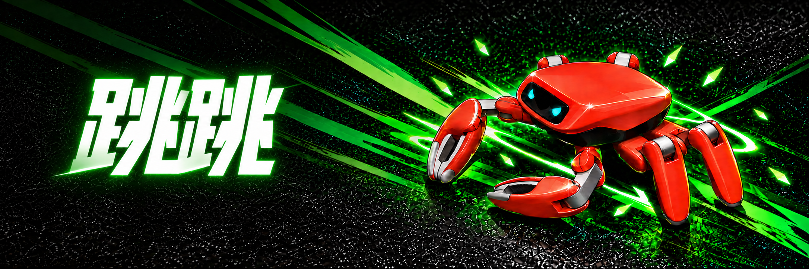
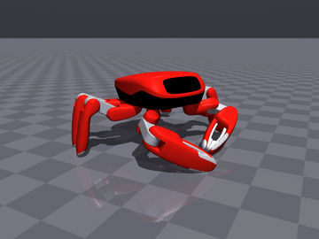
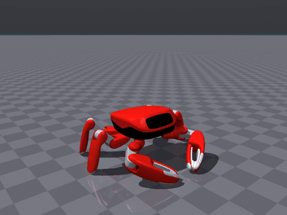
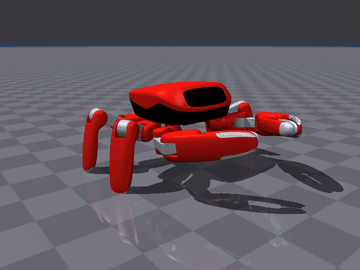
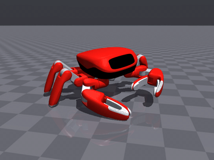
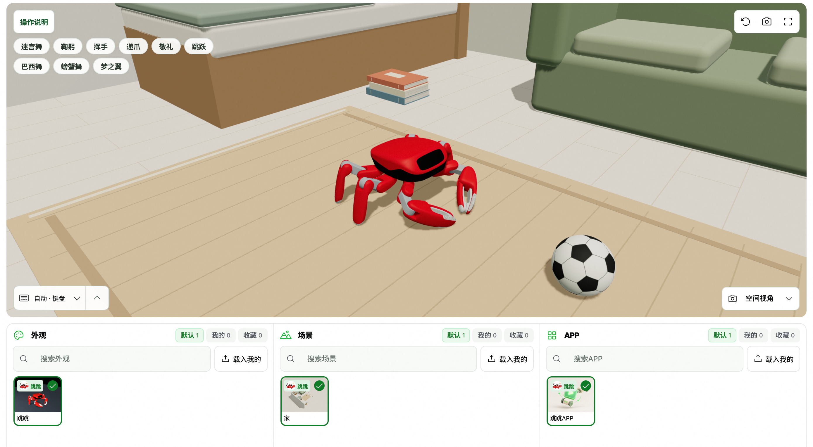
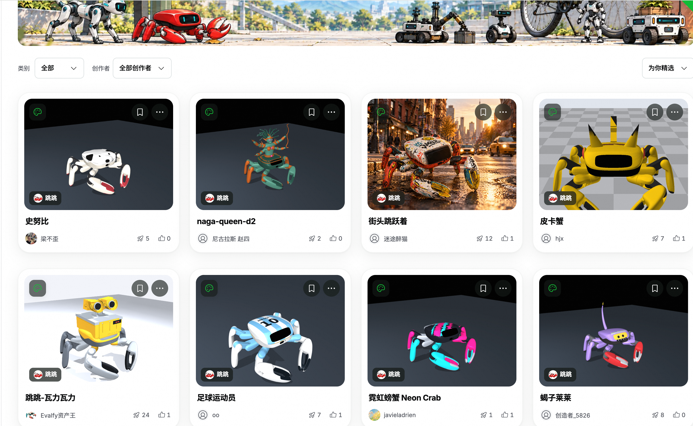

# 从小鸭子到小螃蟹：我在本地训练出了会走路的「跳跳」



## 从 Microduck 说起

之前研究过 Pollen Robotics 的双足小鸭 Microduck：在 mjlab 里用 PPO 练策略，导出 ONNX，再由 Rust 程序在瑞芯微芯片上驱动舵机。金钢科技开源的螃蟹机器人**跳跳（Jumper）**走的是同一条路，只是两条腿换成了六条腿加两只钳子。

## 认识跳跳

22 个触觉舵机、RK3576 主控、重 1.8 kg，能走（≥ 0.5 m/s）、能跳（≥ 400 mm）、能跳舞、能抓（1 kg）。

| 走路 | 跳跃 | 跳舞 | 抓取 |
|---|---|---|---|
|  |  |  |  |

官网的网页模拟器跑的就是编译成 WebAssembly 的 Rust 控制器，下方三栏外观、场景、APP 对应"好看、好玩、有用"。



外观可以一句话交给 AI 设计，社区已有不少作品。官方开源动作大赛（9/30–11/30）将送出 100 台跳跳。



## 技术要点

- **训练**：mjlab + rsl_rl（PPO），MuJoCo Warp 在 GPU 上并行数千个环境，18 个任务各占一个目录。
- **部署**：`.pt → ONNX + layout.json → RKNN`，`layout.json` 是唯一参数来源；同一份 Rust 状态机编译成板端、网页、仿真三种形态。

## 本地实测

RTX 5090 + PyTorch 2.11（cu130），`jumper.tripod` 默认 4096 个环境、10000 轮，约 4 小时：

```bash
python scripts/train.py --task jumper.tripod --headless
```

<video src="train.mp4" controls width="100%"></video>

第 2500 轮起每回合都能走满，全程 0 摔倒，速度范围升到 0.5 m/s，最终奖励 104.8。回放 `model_9999.pt`，三角步态走得很稳：

<video src="play.mp4" controls width="100%"></video>

下一步是导出部署包、上真机。官方也说明，板端推理尚未在真机上完成验证。

> 项目：<https://github.com/KingKongRobotics/jumper> · 官网：<https://kingkong.tech/jumper> · 大赛：<https://beunlimited.me/zh/events/crab-robot-challenge-2026>
